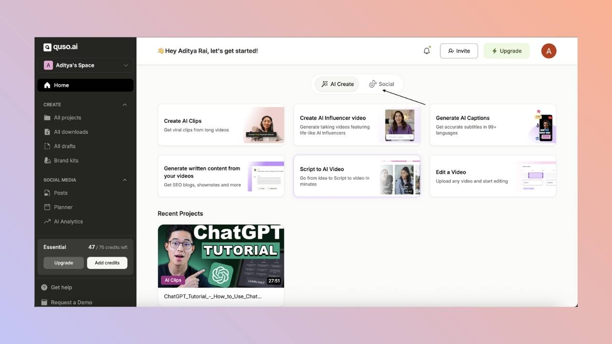
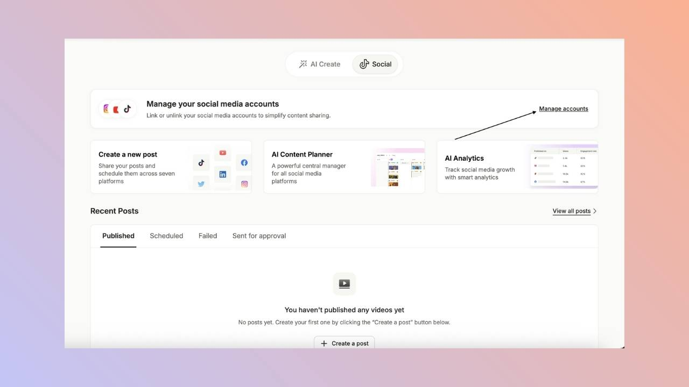
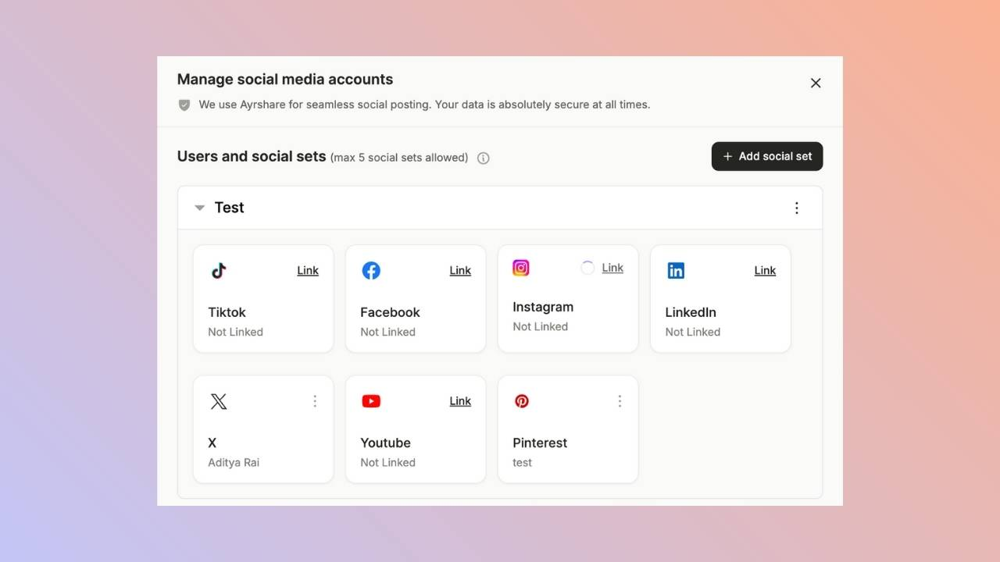

## Supported Social Media Platforms

quso.ai publishes to **12 social networks**. Each [social set](/help/what-is-a-social-set) holds **one account per network**, and you can add more social sets to post for more brands or clients. Reach out to us at [help@quso.ai](mailto:help@quso.ai) if you need help linking an account.

<AccordionGroup>
  <Accordion title="Facebook">
    Learn how to connect your [Facebook Page](/help/connect-facebook-account)
  </Accordion>

  <Accordion title="Instagram">
    Connect your Instagram Profile by [following the steps here](/help/connect-instagram-account)
  </Accordion>

  <Accordion title="YouTube">
    You can [connect your YouTube channels](/help/connect-youtube-account) for seamless posting of videos and shorts.
  </Accordion>

  <Accordion title="LinkedIn">
    Connect Your [LinkedIn Profile or Page](/help/connect-linkedin-account)
  </Accordion>

  <Accordion title="TikTok">
    How to [Connect Your TikTok Account](/help/connect-tiktok-account)
  </Accordion>

  <Accordion title="X/Twitter">
    Here are the steps to connect your [X/Twitter](/help/connect-twitter-account) account.
  </Accordion>

  <Accordion title="Pinterest">
    Here are the steps to connect your [Pinterest](/help/connect-pinterest-account) board
  </Accordion>

  <Accordion title="Bluesky">
    Link Bluesky with your handle and an app password: [Connect Bluesky](/help/connect-bluesky-account)
  </Accordion>

  <Accordion title="Threads">
    Link Threads by signing in with Instagram: [Connect Threads](/help/connect-threads-account)
  </Accordion>

  <Accordion title="Telegram">
    Link a channel or group by adding our bot as an admin: [Connect Telegram](/help/connect-telegram-account)
  </Accordion>

  <Accordion title="Reddit">
    Link Reddit and post to any subreddit: [Connect Reddit](/help/connect-reddit-account)
  </Accordion>

  <Accordion title="Snapchat">
    Link a public professional profile: [Connect Snapchat](/help/connect-snapchat-account)
  </Accordion>
</AccordionGroup>

## Understanding Social Sets

We support linking of "sets" of social media accounts. All paid plans come with 1 set of accounts.

Each social set holds one account on each network: TikTok, Instagram, Facebook, LinkedIn, X, YouTube, Pinterest, Bluesky, Threads, Telegram, Reddit and Snapchat. You can purchase and set up multiple social sets.

The <u>Lite plan</u> offers only Tiktok account linking.\
<u>Essential</u> & <u>Growth plans</u> allow you to link all 12 networks listed above in sets.

<Info>
  Social sets are incredibly helpful when you want to connect social media accounts of multiple clients that you are working with.
</Info>

## Connect Your Social Media Accounts

1. Click on the **Social tab** from the home page:
   
2. Once you are in the Social tab, click on the **Manage Accounts** button
   
3. You can then click on the link button for the social media account that you wish to connect with the platform.
   
4. Once you click on Link, it will take you to a pop-up page where you can select the account you wish to link with our platform.

<Tip>
  Please make sure to disable any pop-up blocker extensions from your web browser while linking your account.
</Tip>

## All Set!

You’ve successfully connected your social media accounts.

Now you can start creating, scheduling, and publishing content directly from our platform.
---

### Need Help?

If you run into any issues or have questions, our support team at [help@quso.ai](mailto:help@quso.ai) is just a message away.
