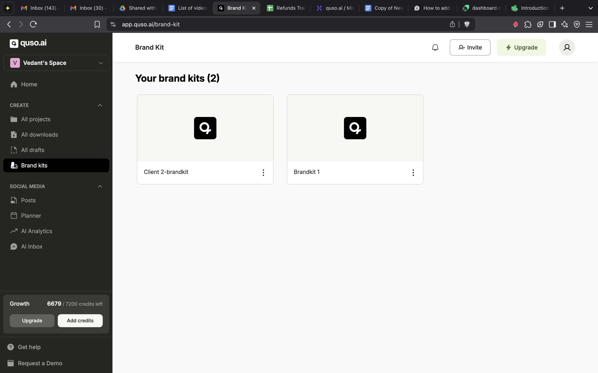
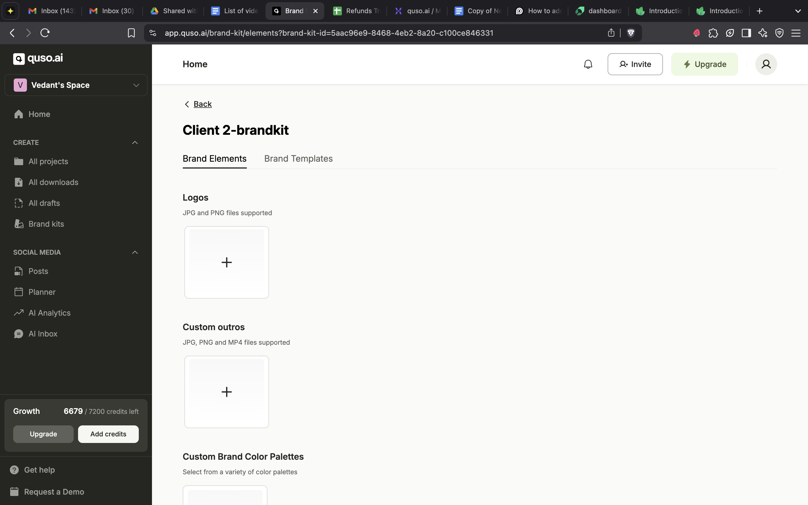
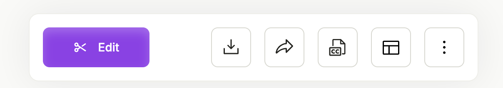
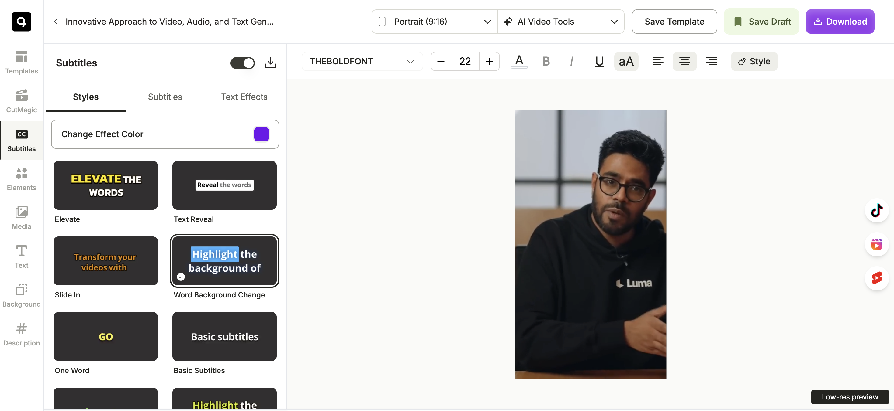
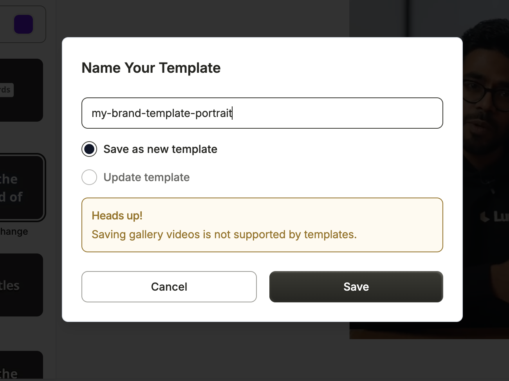
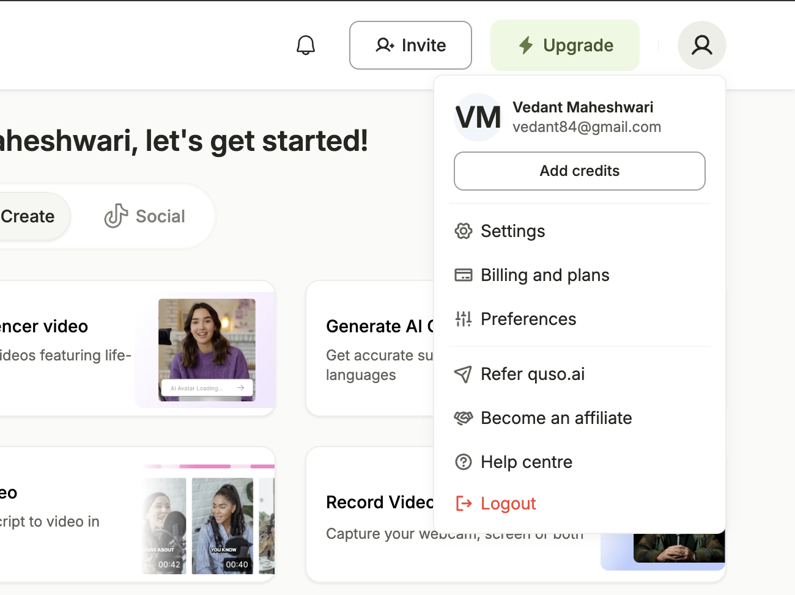
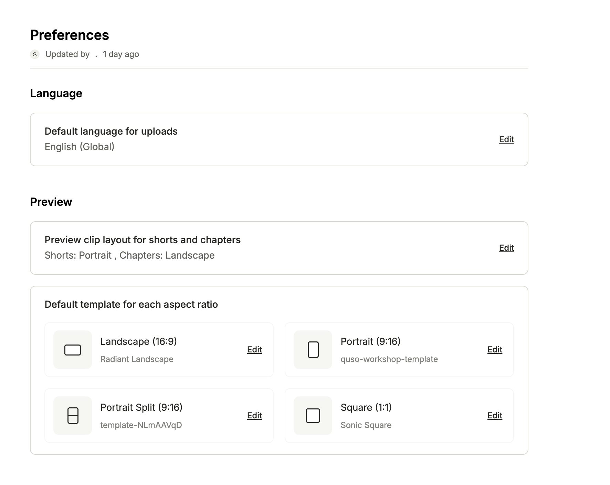

A **brand kit** in quso.ai stores your logo, colors, fonts, outros and other brand assets so every clip looks on brand. You can create **multiple brand kits** on paid plans (the Free plan has 1), each with its own templates, which makes it easy to serve several clients from one dashboard.

<Note>
  Brand templates and custom fonts, colors and music are on the **Growth** plan. Custom logos and outros are on **Essential** and **Growth**.
</Note>

## Setup Your First Brand Kit

You can set up various **Brand Kits & Templates** with your brand color, fonts, logos, and more to make your clips on-brand and more recognizable.

To set up your brand template, click **Brand Kit** on the left side panel.

Open the default brand kit to see all options accessible to you.

You can now add the following items to your brand kit, which can be used and reused inside the editor as well as other parts of the software

- Logo files (JPG, PNG)
- Custom outros (JPG, PNG, MP4)
- Colour palettes
- Fonts (TTF)
- Images
- Videos
- Audio
- Background

## Make your first brand template

To setup your brand template, open up the editor with any video file you have already uploaded on the software. Use the 'Edit' button to do this, and your clip will open in the editor.

Now, feel free to make changes to the clip itself on the editor screen. You can easily change the captions styles, fonts, size, background, add your logo and pretty much customize everything on the editor.

Once you're happy with how the clip looks, you can click on the button on the top right that says "Save Template" and give your template a name, and select "Save as new template".

Your first brand template is now ready\!

<Tip>
  If you're planning to get clips in multiple aspect ratios (ie, portrait, landscape, etc), it's a great idea to create and save a brand template for each of those aspect ratios.
</Tip>

## Set Default Brand Template

You can set your brand template as the default template, so that it is applied to all videos and clips that are made in the future.

To do this, head to the home page and click on the profile icon on the top right. Click on "Preferences".

You'll now see various options to set default templates for all clip aspect ratios. Click on the edit option for each aspect ratio you want to set, and apply your new brand template as the default option there.

You're now set\! All new clips will automatically have your brand template applied, and that saves you a ton of time and effort when posting online.

---

### Need Help?

If you run into any issues or have questions, our support team at [help@quso.ai](mailto:help@quso.ai) is just a message away.
