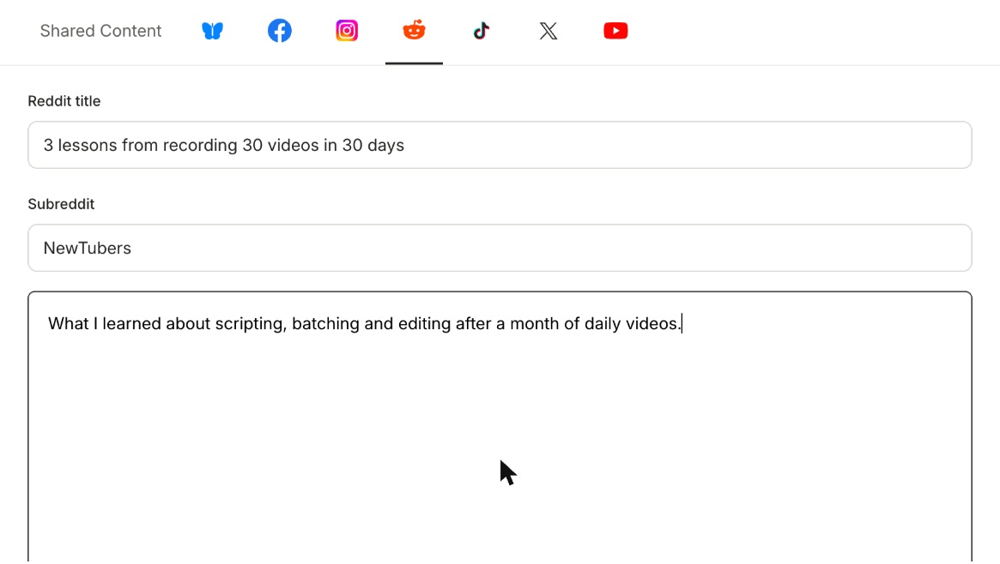

Post and schedule to **Reddit** from quso.ai. Each Reddit post goes to one **subreddit** and needs a **title**.

<Note>
  Reddit is available on plans that include social publishing, such as **Essential** and **Growth**.
</Note>

---

## Link Reddit

### Step 1: Open Manage accounts

Go to **Social Media → Posts** and click **Manage accounts**.

### Step 2: Click Link on Reddit

A new window opens. Sign in to Reddit if you aren't already.

### Step 3: Allow access

Click **Allow**. Your Reddit username now appears on the Manage accounts page.

---

## Post to Reddit

### Step 1: Select Reddit in the composer

Click **New post**, select your Reddit account and open the **Reddit** tab.

### Step 2: Add a title and a subreddit

- **Reddit title:** up to **300 characters**.
- **Subreddit:** the name without `r/`, for example `videography`. If you type `r/`, quso.ai removes it for you.

### Step 3: Add text or an image

- **Text:** up to **5,000 characters**.
- **Image:** **1 image**, up to **10MB**.
- **Video is not supported** on Reddit. If your post has a video, remove Reddit or post text or an image instead.

Then click **Publish Now** or **Schedule**.

<Warning>
  Check the subreddit's rules before posting. Many subreddits limit automated or promotional posts, require flair, or only allow posts from members with some karma. Reddit or the subreddit's moderators may remove posts that break them.
</Warning>

---

## FAQ

<AccordionGroup>
  <Accordion title='It says "Add a title and a subreddit to post on Reddit"'>
    Both fields are required. Open the Reddit tab and fill in **Reddit title** and **Subreddit**.
  </Accordion>
  <Accordion title="Why can't I post my clip to Reddit?">
    Reddit doesn't accept video posts through quso.ai. Post text or an image to Reddit, and send the clip to your other networks.
  </Accordion>
  <Accordion title="My post was published but I can't see it in the subreddit">
    The subreddit's moderators or filters may have removed or held it. Check the subreddit's rules, or message its moderators.
  </Accordion>
</AccordionGroup>

---

### Need Help?

If you run into any issues or have questions, our support team at [help@quso.ai](mailto:help@quso.ai) is just a message away.
