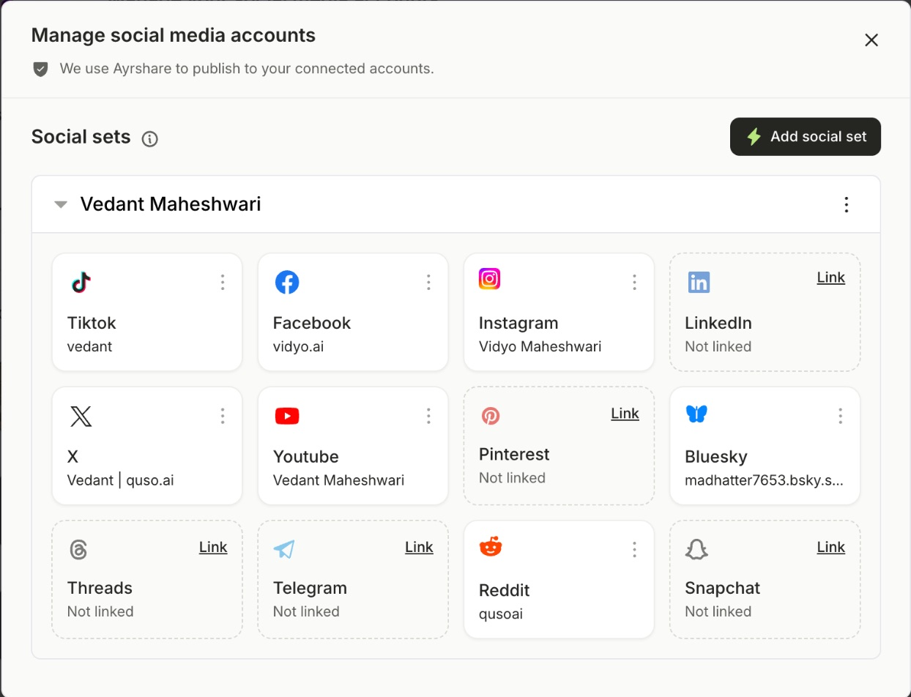

Post and schedule to **Snapchat** from quso.ai. You can send each post to your **Story**, a **Saved Story**, or **Spotlight**.

<Note>
  Snapchat is available on plans that include social publishing, such as **Essential** and **Growth**. You need a **public profile** switched to a **professional profile**.
</Note>

---

## Before you start

Set up a public professional profile in Snapchat:

1. In Snapchat, tap your profile icon in the top-left corner.
2. If you don't have a public profile yet, create one from **Public Profile**.
3. In your profile settings, switch to a **professional profile**, choose a category and confirm.

---

## Link Snapchat

### Step 1: Open Manage accounts

Go to **Social Media → Posts** and click **Manage accounts**.

### Step 2: Click Link on Snapchat

A new window opens. Log in to Snapchat if asked.

### Step 3: Allow access

Review the permissions and click **Continue**. Snapchat now appears on the Manage accounts page.

---

## Post to Snapchat

Open the **Snapchat** tab in the composer and choose where the post goes under **Post to**:

- **Story** (default): shown on your Story for 24 hours.
- **Saved Story:** kept on your profile.
- **Spotlight:** Snapchat's public feed. Spotlight shows only the first **160 characters** of your caption.

Every Snapchat post needs media:

- **1 image**, or **1 vertical video between 5 and 60 seconds**.
- **Caption:** up to **500 characters**.

---

## FAQ

<AccordionGroup>
  <Accordion title="I can't link my Snapchat account">
    Snapchat only links public **professional** profiles. Switch your public profile to a professional profile in Snapchat, then link again.
  </Accordion>
  <Accordion title='It says "Snapchat videos must be 5 to 60 seconds long"'>
    Use a clip between 5 and 60 seconds, or remove Snapchat from this post.
  </Accordion>
</AccordionGroup>

---

### Need Help?

If you run into any issues or have questions, our support team at [help@quso.ai](mailto:help@quso.ai) is just a message away.
