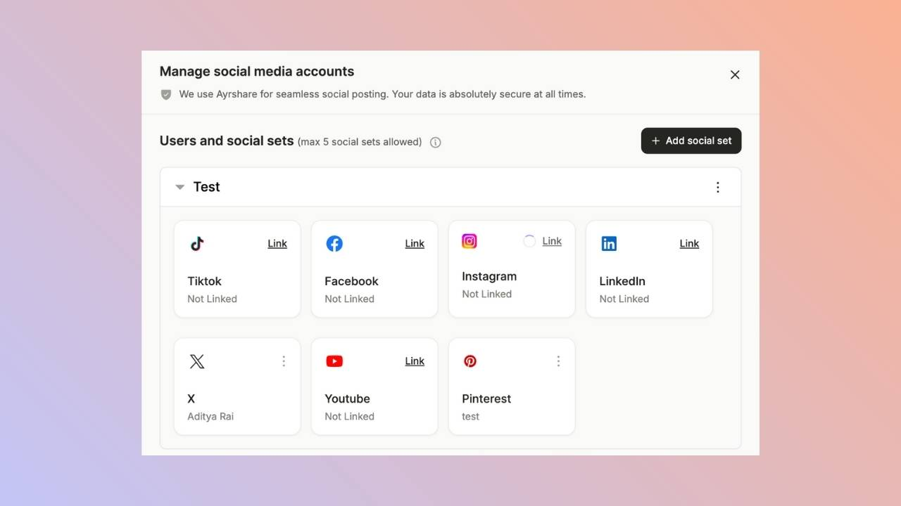
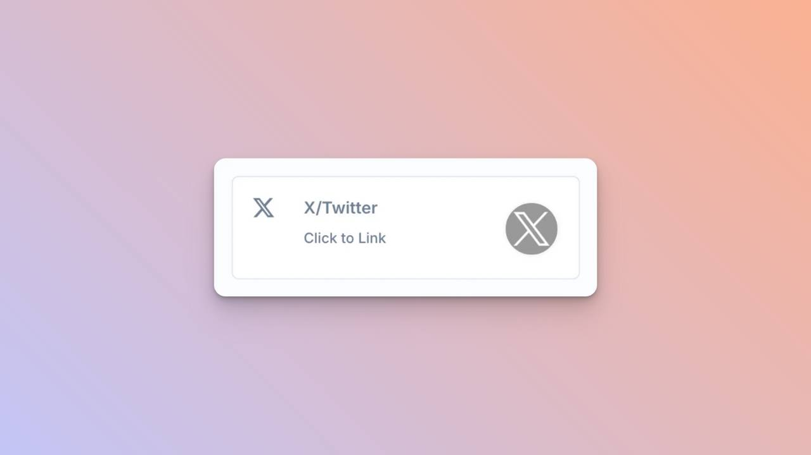
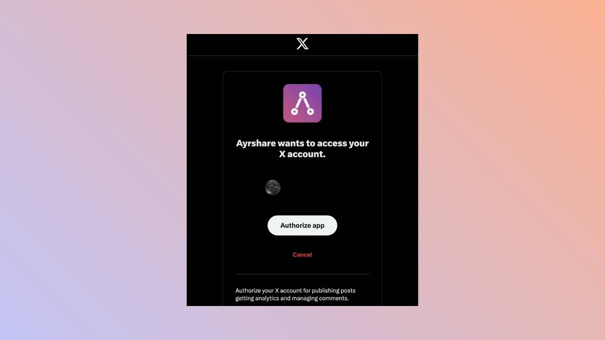
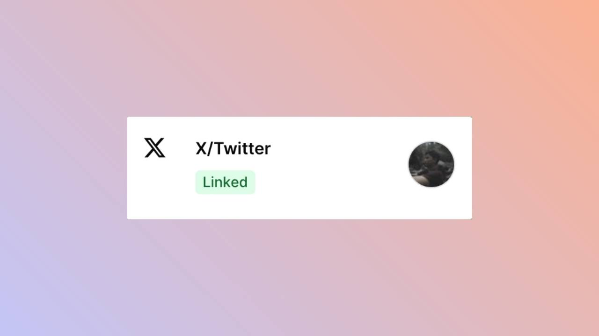

You can connect your **X (formerly Twitter)** account to quso.ai to publish and schedule posts with a video or up to 4 images. Publishing to X is on the Essential and Growth plans.

You can link your X, formerly known as Twitter, account with our platform. When authorizing X, you will be redirected to X to log in and authorize Ayrshare to access your X account.

## Linking X/Twitter

### **Go to the Manage Accounts page**

Open the manage accounts page from the social tab and click on the link button. This will open a new tab.

### **Social Accounts Page**

Click **X/Twitter - Click to Link** button on the Social Accounts page.

### **First Time X Linking**

When you click the X icon on the Social Accounts page, an X sign-in will pop up - _please be sure you allow pop-ups_. If you are already logged in, please proceed to the following step.\
Click _Sign In_, follow the instructions, and input relevant login credentials.

### **Authorize Access**

If you have already signed in, click **Authorize app** on the pop-up.\
This will authorize Ayrshare to access your X account.

### **Confirmation**

Your Social Accounts page will now be updated with your X account.

## You're All Set\!

You’ve successfully linked your X account to our platform\! \
You can now **post or schedule media** directly through our dashboard with ease.\
---

### Need Help?

If you run into any issues or have questions, our support team at [help@quso.ai](mailto:help@quso.ai) is just a message away.
