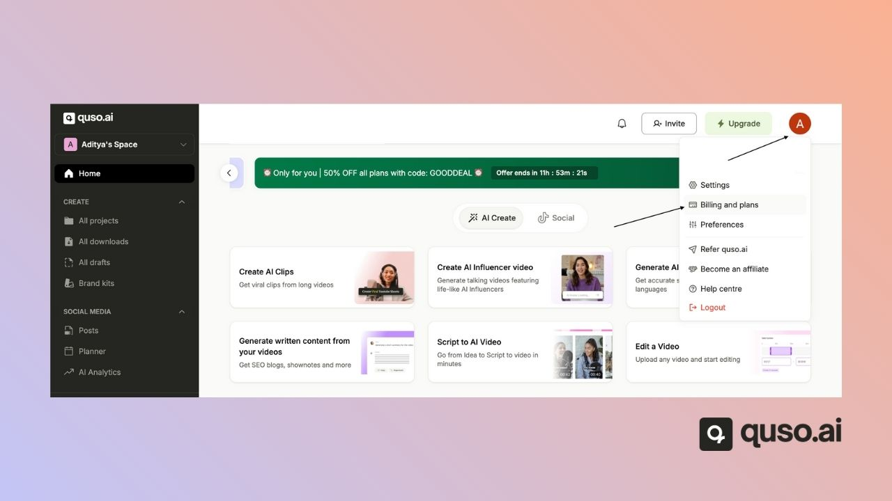
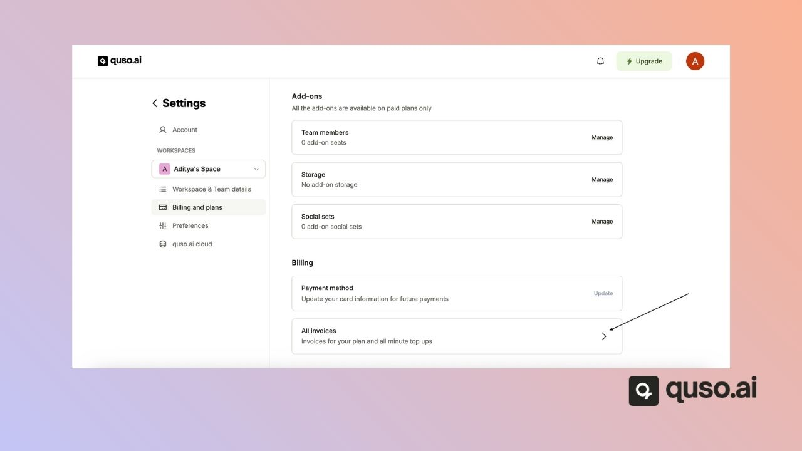

Every quso.ai payment comes with an invoice issued by **Paddle**, our payment provider. The workspace owner can download past invoices at any time from **Settings → Billing & Plans**, or ask the support team for a copy.

---

## Where can I find my invoices?

### Step 1: Go to Billing & Plans

Open **Settings** and select **Billing & Plans**.

### Step 2: Find the invoice

Scroll down to the invoices list and download the invoice you need.

---

## FAQ

<AccordionGroup>
  <Accordion title="Can I add my company name or tax ID to an invoice?">
    Email [help@quso.ai](mailto:help@quso.ai) with the details you need on the invoice.
  </Accordion>
  <Accordion title="I'm a team member and can't see invoices. Why?">
    Billing belongs to the workspace owner. Ask the owner to download the invoice, or email support from the owner's account email.
  </Accordion>
</AccordionGroup>

---

### Need Help?

If you run into any issues or have questions, our support team at [help@quso.ai](mailto:help@quso.ai) is just a message away.
