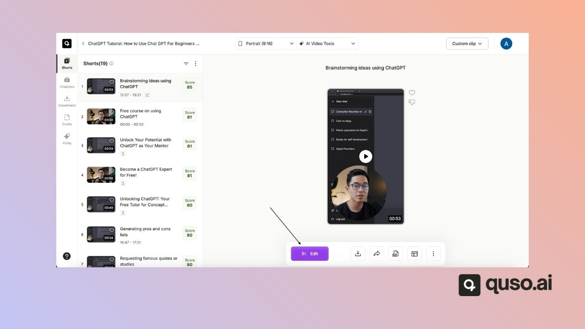
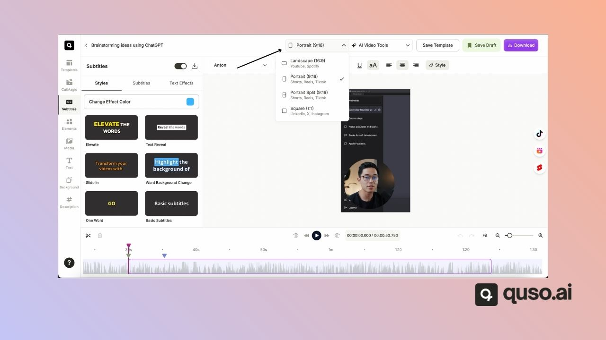
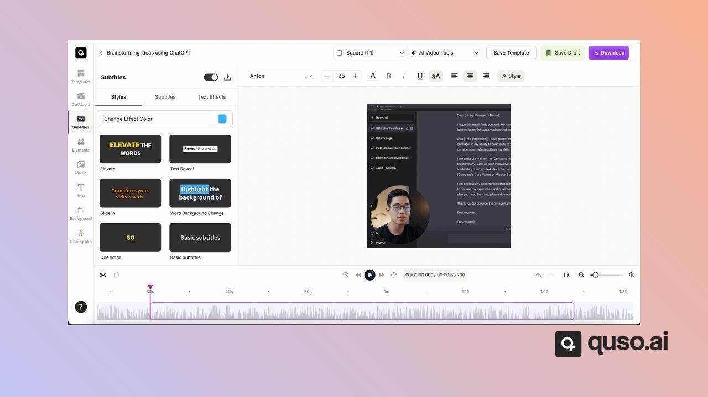

This guide explains how to change the aspect ratio of your clips directly in the editor. Adjusting the aspect ratio allows you to optimize your videos for different platforms such as YouTube, Instagram, LinkedIn, or Twitter.

<iframe width="560" height="315" src="https://www.youtube.com/embed/d1uODwTDlh8?si=sPatNzhPYXrwWq0g" title="YouTube video player" frameborder="0" allow="accelerometer; autoplay; clipboard-write; encrypted-media; gyroscope; picture-in-picture; web-share" referrerpolicy="strict-origin-when-cross-origin" allowfullscreen />

---

### Steps to Change Aspect Ratio

**Step 1:** Open the editor for the clip you want to adjust.

**Step 2:** On the top ribbon, click the aspect ratio button (it will display the current ratio, such as Portrait).

**Step 3:** Choose your desired aspect ratio:

- **Landscape (16:9)** – Best for YouTube and widescreen platforms.
- **Square (1:1)** – Great for LinkedIn, Facebook, and Twitter.
- **Portrait (9:16)** – Ideal for Instagram Stories, TikTok, and Reels.

**Step 4:** Your clip will instantly update to the selected aspect ratio. You can switch back anytime as needed.

---

That’s it\! With just a few clicks, you can resize your video to match the requirements of any social media platform.

---

### Need Help?

If you run into any issues or have questions, our support team at [help@quso.ai](mailto:help@quso.ai) is just a message away.
