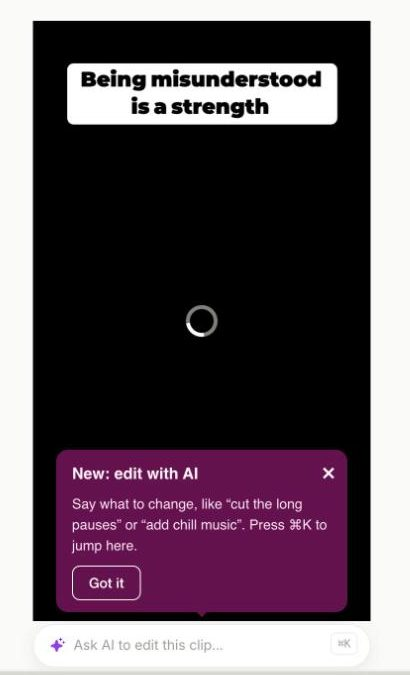
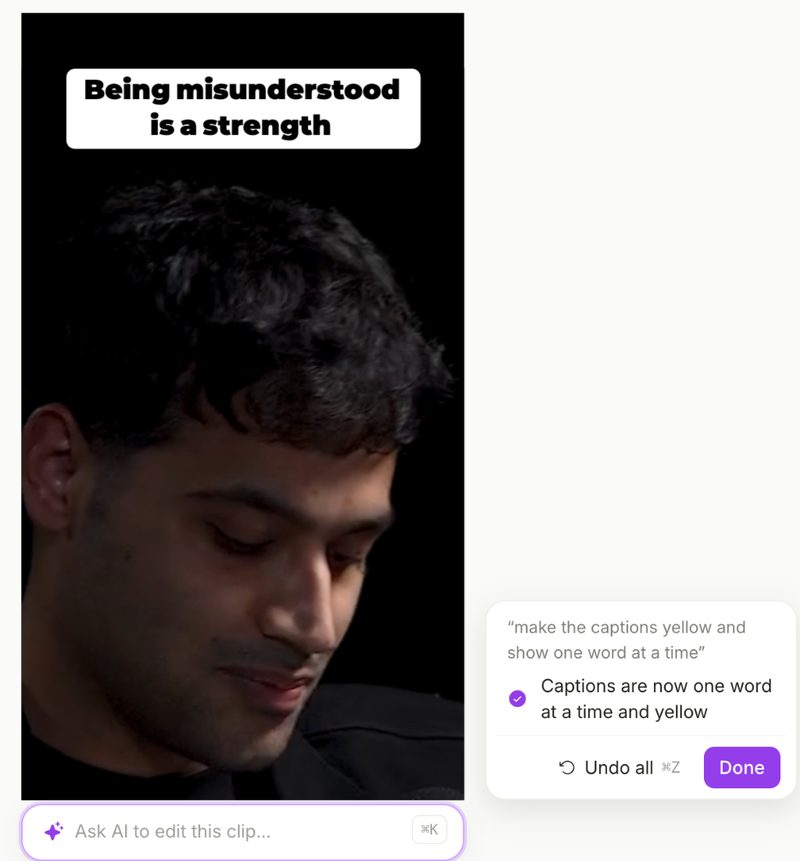
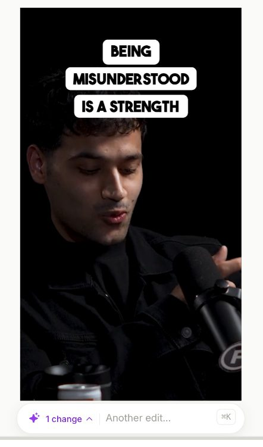
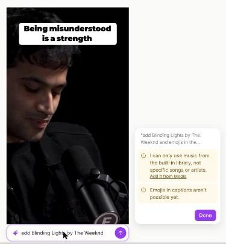

**Edit with AI** lets you change a clip by typing what you want, the way you'd ask a video editor. Type "cut the long pauses" or "add a hook at the start", and quso.ai makes the edit in the editor for you. You can see it right away, keep it, or undo it.

<Note>
  Edit with AI is in the new quso.ai editor and is rolling out gradually. If you don't see the **Ask AI to edit this clip…** bar under your video yet, it hasn't reached your account.
</Note>

---

## Find the AI bar

Open any clip in the editor. The **Ask AI to edit this clip…** bar sits just under the video. Click it, or press **⌘K** (**Ctrl+K** on Windows) to jump straight to it.

When you click into the bar with nothing typed, it suggests a few edits that fit your clip, such as how many long pauses or filler words it found. Click one to try it.

---

## Ask for a change

### Step 1: Say what you want

- Type your request in your own words. You can ask for several things at once: "make the captions yellow and show one word at a time".

### Step 2: Send it

- Press **Enter** or click the arrow. It takes a few seconds. Press **Esc** to stop.

### Step 3: Check the result

- A card next to the video lists every change it made. Play the clip to see them.

---

## What you can ask for

| You can ask… | For example |
|---|---|
| **Captions:** color, font, size, uppercase, position, animation, or turn them off | "bigger captions at the top", "show one word at a time" |
| **Cut by what's said:** remove a part of the clip by describing it | "cut the part where I talk about pricing" |
| **Cut pauses and filler words** | "tighten it up", "remove the ums" |
| **Trim** the start or end | "cut the first 3 seconds" |
| **Hook or call to action:** text written for you, in a readable box | "add a hook at the start", "add a follow CTA at the end" |
| **Background music** from the quso.ai music library, by mood, and its volume | "add some chill music", "make the music quieter", "remove the music" |
| **Zoom** the whole clip in or out | "zoom in a bit", "reset the zoom" |
| **Progress bar** | "add a progress bar" |
| **Background color** and the on-video **title** | "black background", "turn off the title" |
| **Export speed** | "speed it up" (faster than 1× is on paid plans) |

<Tip>
  Follow-ups work: after a change, say "a bit smaller", "no, at the top" or "undo that".
</Tip>

---

## When it can't do something

If you ask for something it can't do yet, the card says so and why, and links to the place in the editor where you can do it yourself. Everything else in your request is still done.

Not possible yet:

- A specific song or artist. Music comes from the quso.ai library only. To use your own track, add it from **Media**.
- Emojis in captions, b-roll, transitions, and zooming in at one moment only.

---

## Undo a change

Every request is **one step** in the editor's history:

- Click **Undo all** on the result card, or
- Press **⌘Z** (**Ctrl+Z**), or click Undo in the editor, or
- Type **"undo that"** in the bar.

---

## FAQ

<AccordionGroup>
  <Accordion title="Does it change my original video?">
    No. It makes the same edits you could make by hand in the editor, on this clip only. Your source video is never changed, and every change can be undone.
  </Accordion>
  <Accordion title="Why did it say a part isn't in my clip?">
    It only cuts words it can clearly match to what you described. If that part of the conversation is outside this clip, it tells you instead of cutting something else.
  </Accordion>
  <Accordion title="Why didn't my export come out faster?">
    Faster export speeds are part of paid plans. On the free plan, the AI tells you instead of changing the speed. The preview always plays at normal speed; the speed applies to the downloaded video.
  </Accordion>
  <Accordion title="Can I edit what it added?">
    Yes. Added text, music and caption changes are normal editor layers and settings. Change them with the usual tools, for example [Change text style and effects](/help/editor/change-text-style-and-effects) or [Add music to your clips](/help/editor/add-music-to-clips).
  </Accordion>
</AccordionGroup>

---

### Need Help?

If you run into any issues or have questions, our support team at [help@quso.ai](mailto:help@quso.ai) is just a message away.
