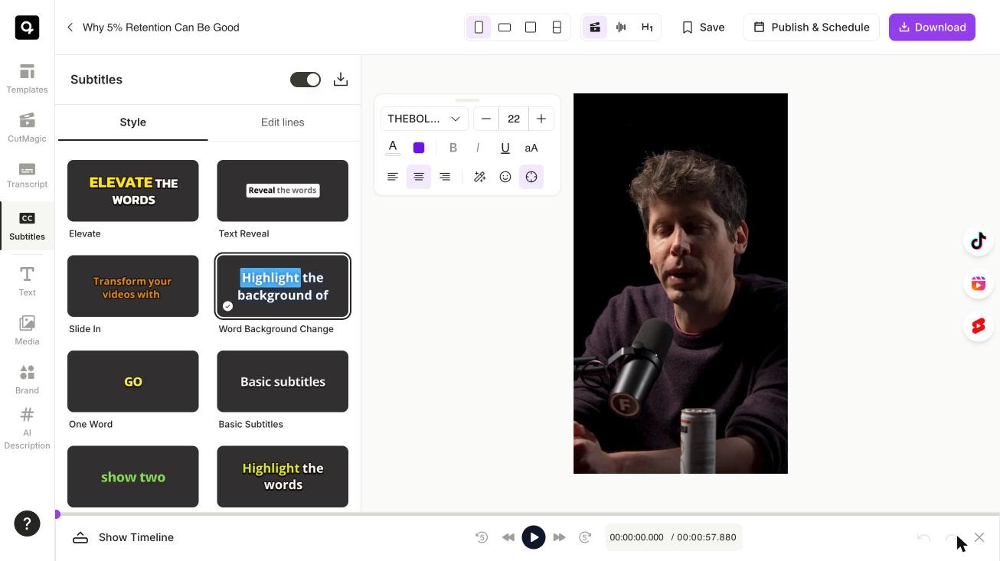
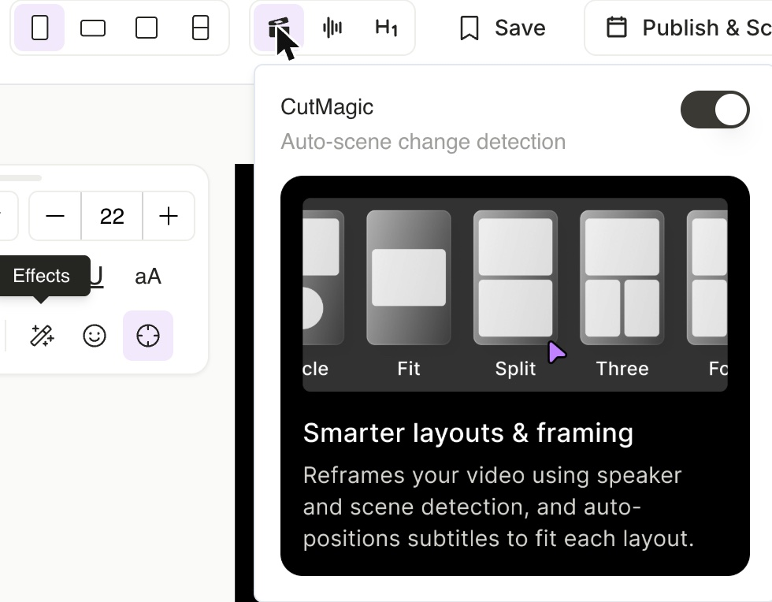
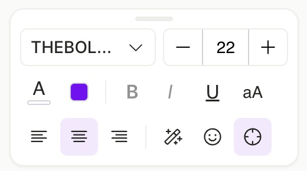
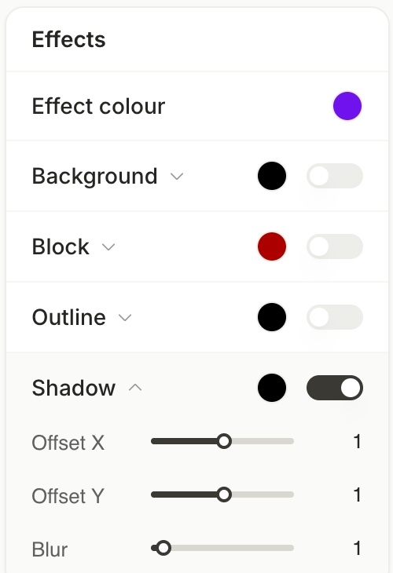
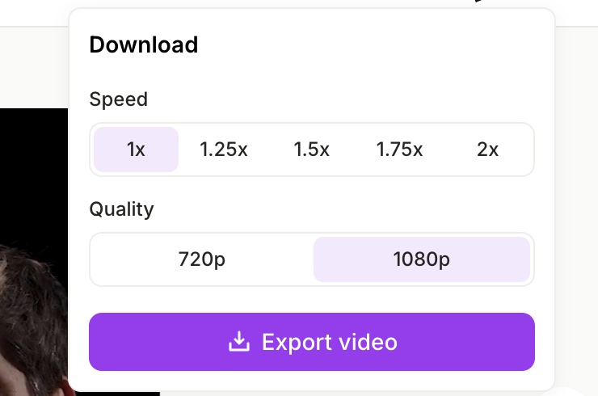

The quso.ai editor keeps your video in the middle and puts every control one click away. This guide shows where each one lives.

---

## The top bar

Everything you change for the whole clip sits in the top bar.

- **Aspect ratio:** the first group of icons switches between Portrait (9:16), Landscape (16:9), Square (1:1) and Portrait Split. The highlighted icon is your current ratio.
- **AI tools:** the second group holds **CutMagic**, **Filler word removal** and **AI headline**. A tool is on when its icon is highlighted.
- **Save** saves your clip as a draft.
- **Publish & Schedule** posts the clip to your connected accounts.
- **Download** exports the video.

### Turn an AI tool on or off

1. Hover over the tool's icon in the top bar.
2. Use the switch at the top of the card to turn it on or off. The card also shows what the tool does.

---

## The style card

When you select captions or a text box on your video, a small style card appears next to the video. It holds everything for styling that selection:

- **Row 1:** font and size.
- **Row 2:** text colour, effect colour, bold, italic, underline, and capitalisation (aA).
- **Row 3:** alignment, **Effects**, **Emoji**, and auto position.

<Tip>
  Drag the small bar at the top of the card to move it anywhere over the canvas. Double-click the bar to put it back next to your video.
</Tip>

---

## Add effects

1. Select your captions or a text box.
2. In the style card, click the **Effects** icon (the magic wand).
3. Turn an effect on with its switch: **Background**, **Block**, **Outline** or **Shadow**.
4. Click the round swatch to change the effect's colour.
5. Click the effect's name to open its settings, such as offset, blur, padding or radius, right below it.

---

## Download your video

1. Click **Download** in the top bar.
2. Choose a **Speed** (1x to 2x) and a **Quality** (720p or 1080p).
3. Click **Export video**.

Your video appears in **All downloads** when it's ready. Press **Esc** or click anywhere outside the menu to close it without exporting.

---

## Related guides

- [Change caption style, font and effects](/help/editor/change-caption-style-font-effects)
- [Add a text overlay to your video](/help/editor/add-text-overlay-to-video)
- [Change the video size or aspect ratio](/help/editor/change-video-size-or-aspect-ratio)
- [AI Headline](/help/editor/ai-headline)
