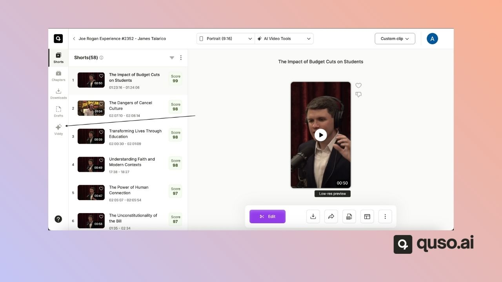
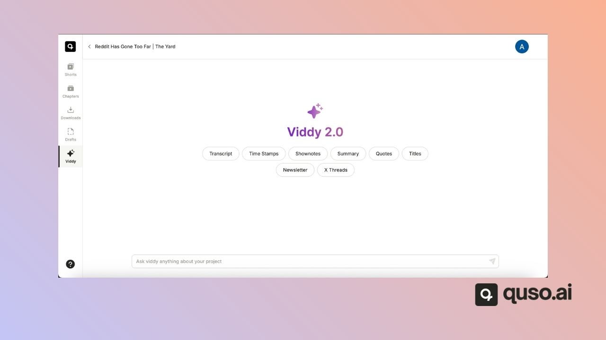

quso.ai writes a word-level transcript for every video you import. You can **copy** the transcript as text from AI Writer or Viddy, or **download** a clip's captions as an **SRT file** from the editor on paid plans (Lite, Essential, Growth and Plus). There is no TXT or DOCX download.

---

## Copy the full transcript from AI Writer

1. Open an **AI Writer** project. To start one, click **AI Writer** on the home page and import your video or audio.
2. In the **Content** list on the left, choose **Transcript**. Choose **Time stamps** for a list of timestamps.
3. Copy the text from the editable box.

## Ask Viddy for the transcript

On the Essential and Growth plans you can also use Viddy:

1. Open your project and click **Viddy** in the side menu.

   
2. Choose the **Transcript** suggestion, or type your own prompt.

   
3. Click the **Copy** button under the answer.

## Download captions as an SRT file

1. Open a clip in the editor.
2. Go to the **Subtitles** tab.
3. Click the download option to save the captions as an `.srt` file.

The SRT file contains the clip's captions with their timings, ready to upload to YouTube or another video platform.

---

## FAQ

<AccordionGroup>
  <Accordion title="Can I download the transcript as a Word or text file?">
    No. Copy the text from AI Writer or Viddy and paste it into your document, or download captions as an SRT file.
  </Accordion>
  <Accordion title="Is SRT download available on the Free plan?">
    No. SRT download is on Lite, Essential, Growth and Plus.
  </Accordion>
</AccordionGroup>

---

### Need Help?

If you run into any issues or have questions, our support team at [help@quso.ai](mailto:help@quso.ai) is just a message away.
