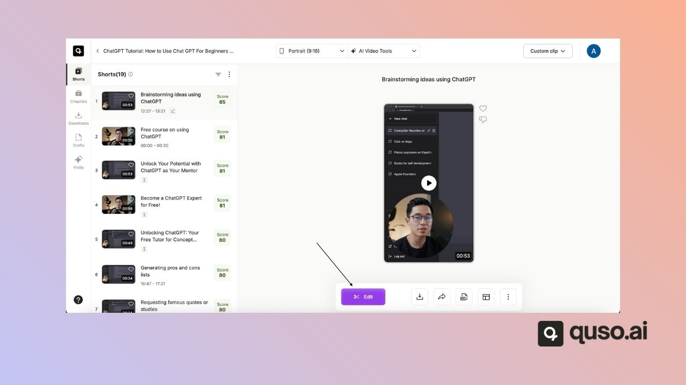
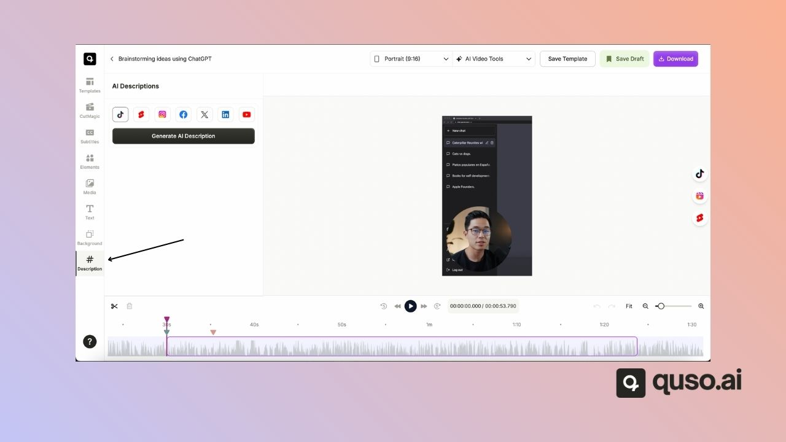
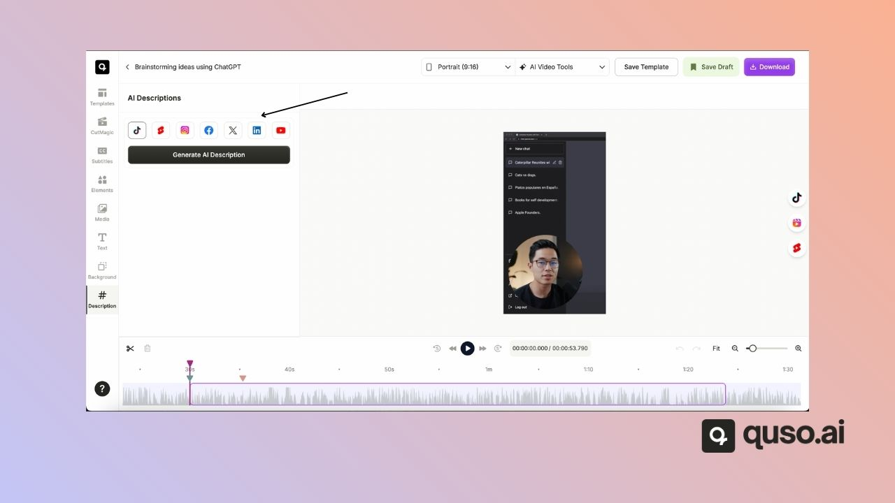
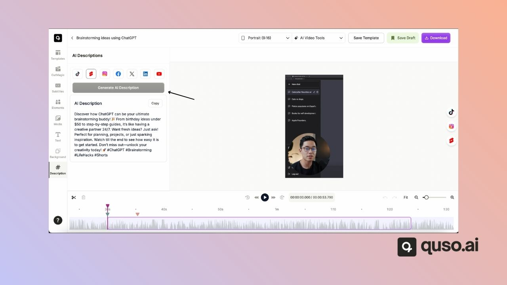

The **AI Description tool** helps you quickly generate optimized captions and descriptions for your video uploads. With support for multiple platforms, it ensures your content is tailored for the site where you’ll be publishing.

<Note>
  AI Description is available on paid plans (Lite, Essential, Growth and Plus).
</Note>

---

## 🎬 Steps to Generate an AI Description

### Step 1: Open the Editor

- Go to the **editor** for the clip whose description you want to generate.

---

### Step 2: Select AI Description

- From the **menu on the left**, click on **AI Description**.

---

### Step 3: Choose a Platform

- Select the platform you want to generate the description for.
- You can choose from **7 different platforms**, including:
  - Facebook
  - Instagram
  - YouTube
  - And more…

---

### Step 4: Generate the Description

- Once you’ve chosen the platform, click **Generate AI Description**.
- The system will instantly create a platform-optimized description for your video.

---

## ✅ Why Use AI Description?

- Save time writing descriptions manually
- Ensure your captions are **optimized for each platform**
- Improve engagement with relevant, AI-generated copy

---

With the AI Description tool, you can make your video uploads faster, easier, and more effective across multiple platforms.

---

### Need Help?

If you run into any issues or have questions, our support team at [help@quso.ai](mailto:help@quso.ai) is just a message away.
