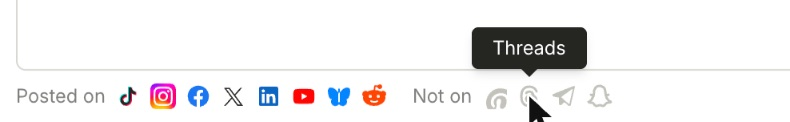
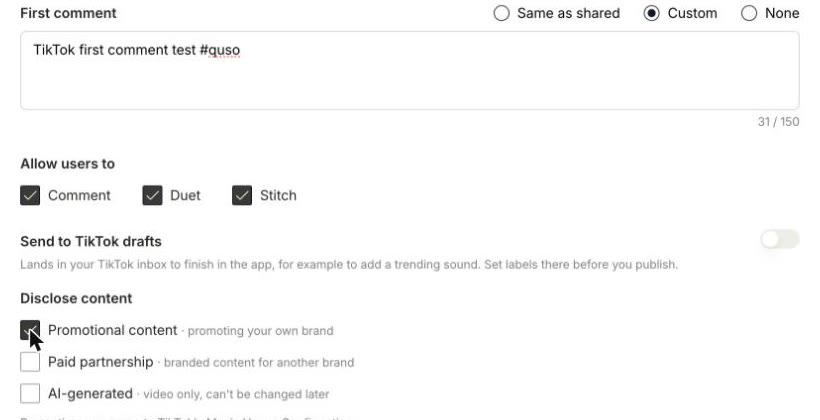

A **first comment** is posted on your post automatically, right after it goes live. Use it for hashtags, a link, or a call to action, so your caption stays clean.

<Note>
  First comments are available on plans that include social publishing, such as **Essential** and **Growth**.
</Note>

---

## Where first comments work

**Posted on:** Facebook, Instagram, LinkedIn, X, YouTube, TikTok, Bluesky and Reddit.

**Not on:** Threads, Snapchat, Telegram and Pinterest, which don't take comments. Instagram and Facebook Stories and TikTok drafts don't take a first comment either.

---

## Add a first comment

### Step 1: Write it once on Shared Content

In the composer, type your comment in **First comment** on the **Shared Content** tab. Every selected network that takes comments posts it.

### Step 2: Change it for one network (optional)

Open a network's tab and choose, under **First comment**:

- **Same as shared:** posts the shared comment (default).
- **Custom:** write a different comment for this network only.
- **None:** no comment on this network.

If you post to a single network, you'll see one first comment box for that network.

### Step 3: Publish or schedule

Click **Publish Now** or **Schedule**. The comment is posted once the post is live. On TikTok, that's after TikTok finishes processing the video.

---

## Comment length by network

| Network | Max characters |
|---|---|
| Facebook | 8,000 |
| Instagram | 2,200 |
| LinkedIn | 1,250 |
| X | 280 (a link counts as 23) |
| YouTube | 10,000 |
| TikTok | 150 |
| Bluesky | 300 |
| Reddit | 10,000 |

If a comment is too long for a network, quso.ai names that network under the box and shows the count in red on its tab. Shorten the comment, or set that network to **Custom** or **None**.

---

### Need Help?

If you run into any issues or have questions, our support team at [help@quso.ai](mailto:help@quso.ai) is just a message away.
