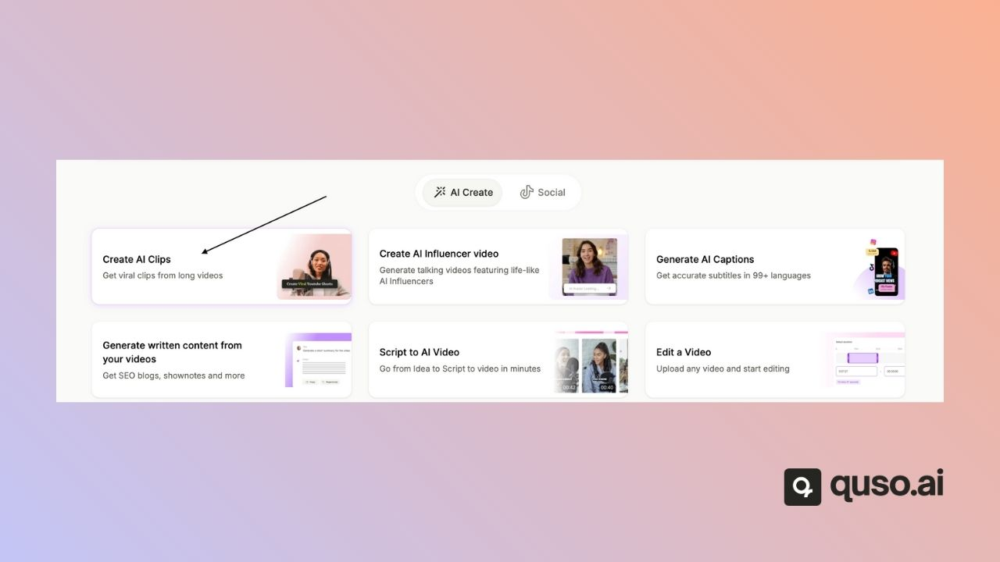
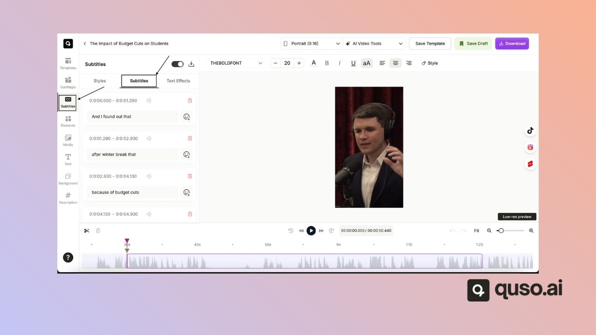
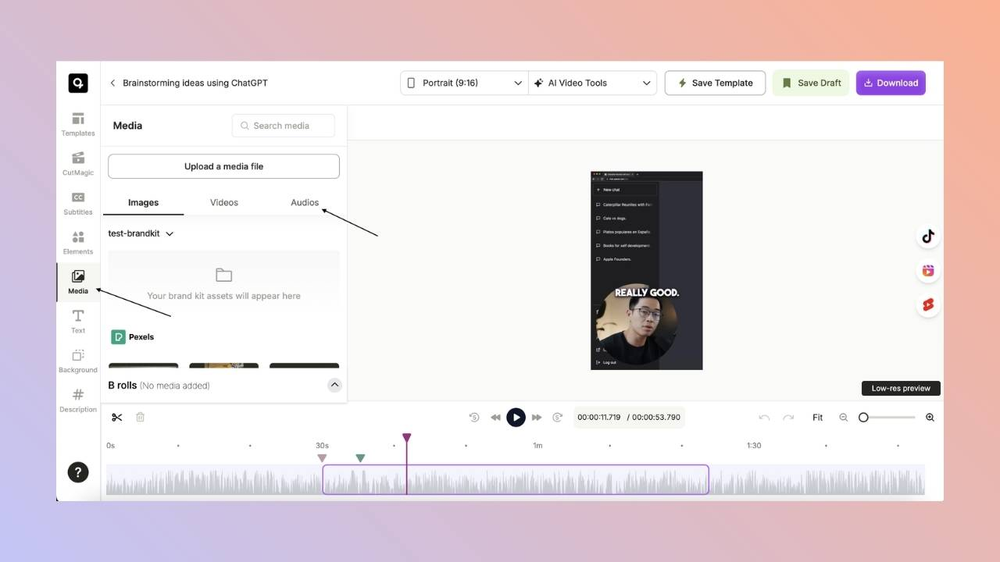
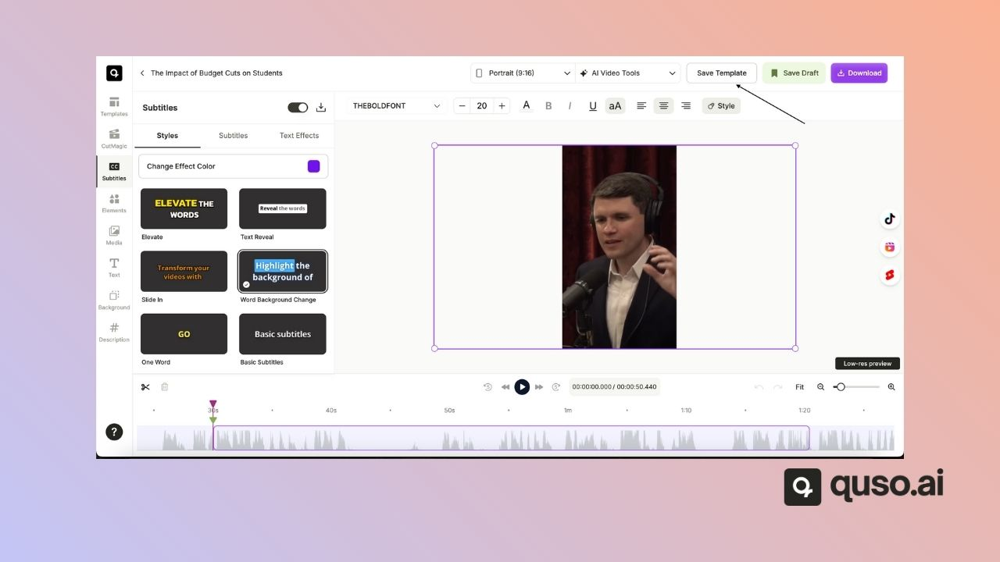
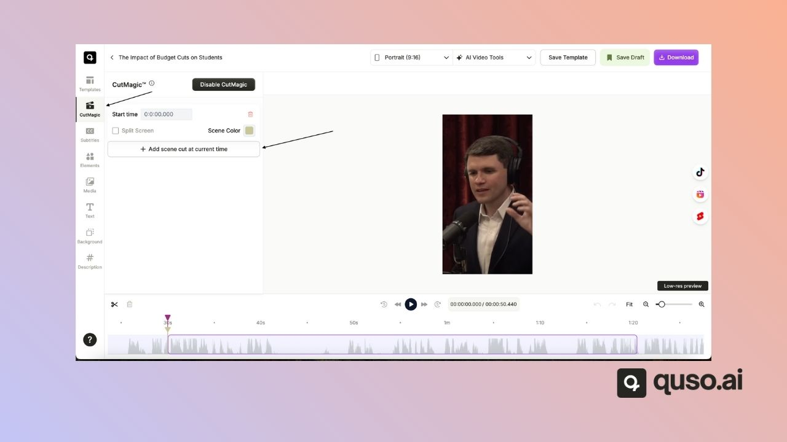
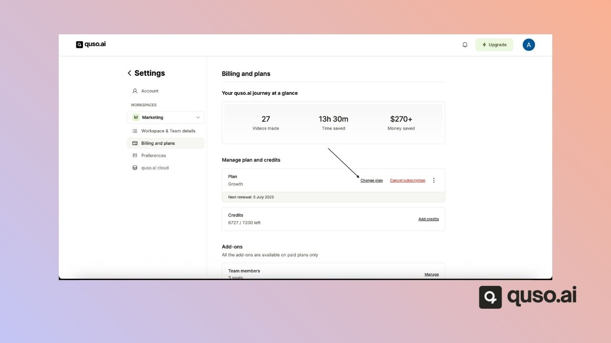
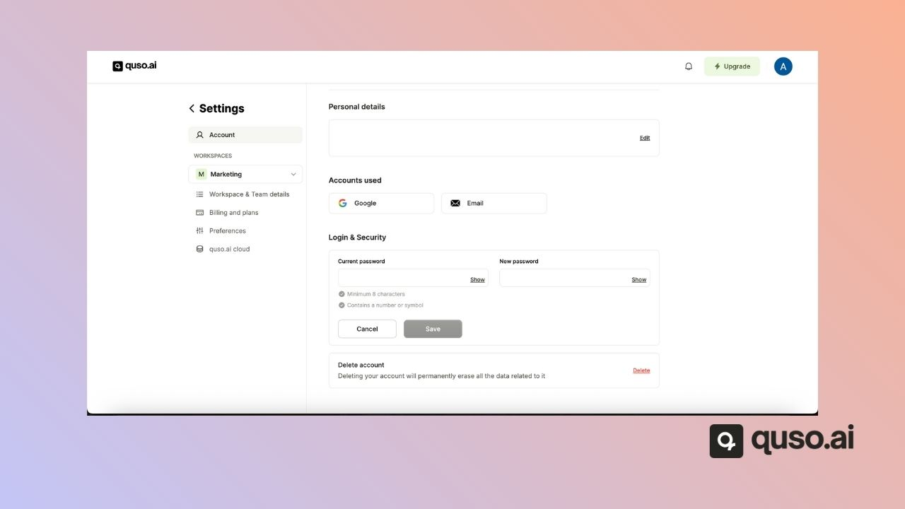
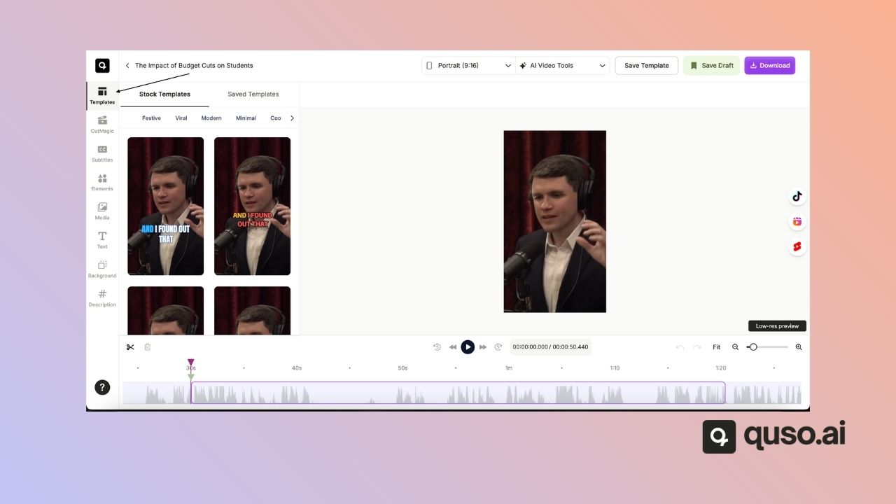

Quick answers to the questions people ask most about quso.ai, the AI tool that turns long videos into short clips, captions videos and publishes them to social media. Each answer links to the full article.

---

## Getting Started

<AccordionGroup>
  <Accordion title="How do I start a new project?">
    1. Log in at [app.quso.ai](https://app.quso.ai).
    2. On the home page, pick what you want to make:
       - **Long to shorts (AI Clips):** short highlight clips from a long video.
       - **AI Captions:** subtitles on a whole video.
       - **AI Writer:** written content from a video or audio file.
    3. Upload a file or paste a link and follow the steps.

    You can also click **New project** at the top right.
  </Accordion>

  <Accordion title="Where is my dashboard and the video editor?">
    After you log in, you land on the home page. If not, click **Home** in the side menu. Open any project and click **Edit** on a clip to open the editor.
  </Accordion>

  <Accordion title="Which file formats can I upload, and how big can they be?">
    MP4, MOV and WebM. AI Writer also takes MP3, WAV and AAC audio.

    - **Free plan:** up to 5 GB per file
    - **Paid plans:** up to 15 GB, or 25 GB for AI Clips

    See [Video import source](/help/video-import-source).
  </Accordion>

  <Accordion title="Which links can I import from?">
    YouTube, Twitch (VODs and clips), Vimeo, Zoom, Loom, Google Drive, Dropbox, X, Facebook, LinkedIn and Rumble. Instagram and TikTok links are not supported. See [Video import source](/help/video-import-source).
  </Accordion>

  <Accordion title="Can I use quso.ai on my phone?">
    Yes, in your phone's web browser. There is no app to install. See [Use quso.ai on mobile](/help/use-quso-ai-on-mobile).
  </Accordion>
</AccordionGroup>

---

## AI Video Creation & Editing

<AccordionGroup>
  <Accordion title="How do I make AI clips from a long video?">
    On the home page, choose **Long to shorts**, add your video, pick the language and click **Generate Clips**.

    

    See [How to use AI Clips](/help/how-to-use-ai-clips).
  </Accordion>

  <Accordion title="How do I add or edit subtitles and captions?">
    In the editor, open the **Subtitles** tab. Click any caption to change the words or timing.

    

    See [Change or correct captions](/help/editor/change-or-correct-captions).
  </Accordion>

  <Accordion title="How do I add background music?">
    In the editor, open the **Audio** tab and choose a track or upload an MP3 or WAV file.

    

    See [Add music to clips](/help/editor/add-music-to-clips).
  </Accordion>

  <Accordion title="Can I rotate or flip a video?">
    No. The editor does not rotate or flip video. Rotate the file before you upload it.
  </Accordion>

  <Accordion title="Can I change the playback speed of a clip?">
    You can change the preview playback speed in the video player. Exported clips play at their original speed.
  </Accordion>

  <Accordion title="How do I save a custom template?">
    After editing a clip, click **Save Template** at the top right, name it and choose **Save as new template**. It appears under the **Templates** tab. Brand templates are on the Growth plan.

    

    See [Create your brand template](/help/editor/create-your-brand-template).
  </Accordion>

  <Accordion title="How do I add a scene cut in CutMagic?">
    In the editor's **CutMagic** tab, move to the point where you want a new scene and click **Add Scene Cut at Current Time**. Then choose a layout for the scene.

    
  </Accordion>

  <Accordion title="Why were no clips generated from my video?">
    - The video has little or no speech. AI Clips finds clips from what is said.
    - The video is very short. Videos under about 3 minutes give few or no clips.
    - The wrong language was selected. If you select English and the video is in French, no clips are generated.

    Credits for a project that fails are refunded automatically.
  </Accordion>

  <Accordion title="Where do my downloaded videos go?">
    While a clip is rendering, you'll find it in the **Downloads** section of the project or the home page. When it's done, the file is saved to your browser's downloads folder.
  </Accordion>
</AccordionGroup>

---

## Plans, Credits & Upgrades

<AccordionGroup>
  <Accordion title="How do credits work in quso.ai?">
    - **1 credit = 1 minute of imported video**, rounded up.
    - The cost is shown **before** processing starts.
    - Editing, downloading and publishing don't use credits.
    - Monthly plan credits reset each month and don't roll over. Annual plans get all 12 months of credits upfront.
    - Add-on credits don't expire.
    - Failed imports are refunded automatically.
    - In team workspaces, members share the credits.

    See [How credits work](/help/how-credits-work).
  </Accordion>

  <Accordion title="What plans does quso.ai have?">
    Free ($0, 75 credits a month), Lite ($29/month, 100 credits), Essential ($39/month, 300 credits) and Growth ($49/month, 600 credits) in the US. Prices and plans can differ by country. See [Subscription plans](/help/subscription-plans).
  </Accordion>

  <Accordion title="What does the “Upgrade” message mean?">
    You have either used up your credits or tried a feature that isn't on your plan. Upgrade or buy extra credits to continue.
  </Accordion>

  <Accordion title="Is the free plan available in my country?">
    It depends on your country. Some accounts get the Free plan with 75 credits a month. Others start on Pay as you go with 0 credits and buy credit packs. Once you buy a pack, you get full features. If you think your account is on the wrong one, email [help@quso.ai](mailto:help@quso.ai).
  </Accordion>

  <Accordion title="Can the Plus plan publish to YouTube?">
    No. Plus doesn't include social scheduling. Scheduling to YouTube and other networks starts on the Essential plan.
  </Accordion>
</AccordionGroup>

---

## Billing & Currency

<AccordionGroup>
  <Accordion title="How do I change the billing currency?">
    You can't change it in the app. quso.ai sets the currency from your location. Email [help@quso.ai](mailto:help@quso.ai) for region-specific issues.
  </Accordion>

  <Accordion title="What is quso.ai's refund policy?">
    Monthly and annual subscriptions are generally non-refundable. If something went wrong, email [help@quso.ai](mailto:help@quso.ai) and the team will review your case.
  </Accordion>

  <Accordion title="How do I cancel my subscription?">
    1. Go to **Settings → Billing & Plans**.
    2. Click **Cancel Plan**.
    3. Your plan stays active until the end of the billing period.

    
  </Accordion>
</AccordionGroup>

---

## Platform Navigation & UI

<AccordionGroup>
  <Accordion title="Where is the upload button?">
    Click **New project** at the top right of the screen, or pick a feature on the home page (Long to shorts, AI Captions or AI Writer). You'll be guided through the upload.
  </Accordion>
</AccordionGroup>

---

## Troubleshooting

<AccordionGroup>
  <Accordion title="Why can't I upload my video?">
    Check:

    - Format: MP4, MOV or WebM
    - File size: within your plan's limit (5 GB on Free, 15–25 GB on paid plans)
    - Credits: the video can't be longer than your remaining credits in minutes
    - Browser: try Chrome, clear the cache or turn off extensions

    If it still fails, email [help@quso.ai](mailto:help@quso.ai).
  </Accordion>

  <Accordion title="Why did my video processing fail?">
    - The video is longer than your remaining credits or the 4-hour link limit
    - The wrong language was selected
    - The video has no speech

    Credits are refunded for failed projects. Try again, or split the video into shorter parts.
  </Accordion>

  <Accordion title="Why can't I download or play my video?">
    - Download again on a stable connection
    - Make sure your device has free space
    - If it still fails, email [help@quso.ai](mailto:help@quso.ai)
  </Accordion>

  <Accordion title="Why does my video look blurry?">
    - Free plan exports are 720p. Paid plans export 1080p.
    - Check the quality of the original video. quso.ai can't add detail that isn't there.
    - If it's still blurry, email [help@quso.ai](mailto:help@quso.ai).
  </Accordion>
</AccordionGroup>

---

## Account Management

<AccordionGroup>
  <Accordion title="I forgot my password. What should I do?">
    Click **Forgot password** on the login page and follow the reset link in the email.
  </Accordion>

  <Accordion title="I didn't receive a verification email. What should I do?">
    - Check your spam folder
    - Make sure you typed your email correctly
    - Request the email again from the login page
    - If it still doesn't arrive, email [help@quso.ai](mailto:help@quso.ai)
  </Accordion>

  <Accordion title="How do I change my password?">
    Go to **Settings → Account** and use **Change password**. This is only available for email-and-password accounts.

    
  </Accordion>

  <Accordion title="How do I log in to quso.ai?">
    Go to [app.quso.ai](https://app.quso.ai) and sign in with Google, Facebook, Microsoft or your email. See [Login options](/help/login-options).
  </Accordion>

  <Accordion title="Is Vidyo.ai the same as quso.ai?">
    Yes. Vidyo.ai was renamed quso.ai in January 2025. Your login, plan, credits and projects carried over.
  </Accordion>

  <Accordion title="How do I delete my account?">
    Go to **Settings → Account → Delete account**. This is permanent. See [Delete your account](/help/delete-account).
  </Accordion>
</AccordionGroup>

---

## Publishing & Advanced Features

<AccordionGroup>
  <Accordion title="Does quso.ai have an API?">
    There is no public API. Email [help@quso.ai](mailto:help@quso.ai) to register your interest.
  </Accordion>

  <Accordion title="Which social networks can I publish to?">
    TikTok, Instagram, YouTube, Facebook, LinkedIn, X, Pinterest, Threads, Bluesky, Telegram, Reddit and Snapchat. The Free and Lite plans publish to TikTok; Essential and Growth publish and schedule to all of them. See [Add social media accounts](/help/add-social-media-accounts).
  </Accordion>

  <Accordion title="How do I schedule a post?">
    1. After editing, click **Publish** on your clip and choose your accounts.
    2. Pick a date and time and click **Schedule**.

    See [Publish or schedule posts to multiple platforms](/help/how-to-bulk-publish).
  </Accordion>

  <Accordion title="How do I use templates?">
    In the editor, open the **Templates** tab and choose a preset template or one of your saved templates.

    
  </Accordion>
</AccordionGroup>

---

## Support

<AccordionGroup>
  <Accordion title="How do I contact quso.ai support?">
    - Use the **Help** button in the app, or the chat widget on this page
    - Email [help@quso.ai](mailto:help@quso.ai)
  </Accordion>
</AccordionGroup>

---

### Need Help?

If you run into any issues or have questions, our support team at [help@quso.ai](mailto:help@quso.ai) is just a message away.
