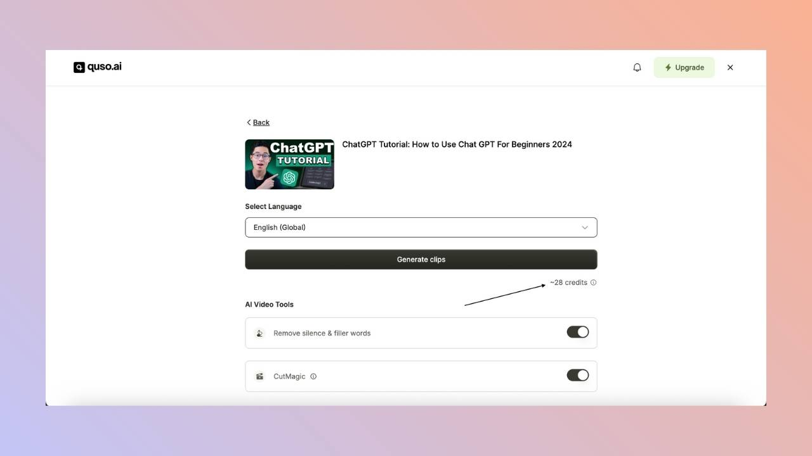
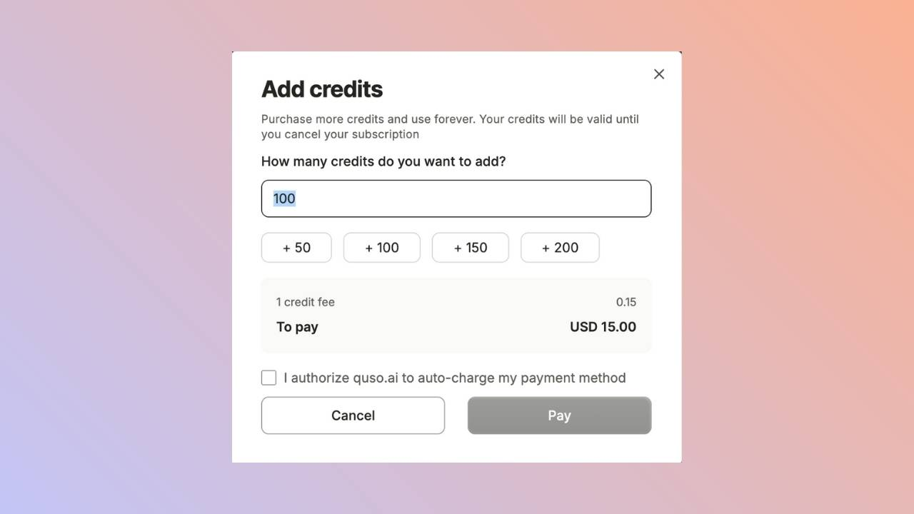

Credits are what you spend to process video in quso.ai. **1 credit = 1 minute of video you import**, rounded up to the next full minute. Every plan, including the Free plan, comes with credits. Editing, downloading and publishing your clips afterwards does not use any more credits.

---

## What uses credits?

Credits are deducted when you import a video, whether you upload a file or paste a link, into:

- **AI Clips** (Long to shorts)
- **AI Captions**
- **AI Writer**

The number of credits is the length of the imported video:

- A 42-minute video uses **42 credits**.
- A 25 min 40 s video is rounded up and uses **26 credits**.
- A 40-second video uses **1 credit**.

<Info>
  The credit cost is always shown before processing starts, so you know how many credits a video will use before any are deducted.
</Info>

The longest video you can import is limited by the credits you have left. On the Free plan, your **first import can be up to 150 minutes**.

---

## When do credits reset?

- **Monthly plans:** your credits reset at the start of each billing month. Unused plan credits do **not** roll over.
- **Annual plans:** you get all 12 months of credits **upfront** when the year starts. They reset at the end of the 12 months.
- **Free plan:** 75 credits renew every month. In a few countries the free credits are a one-time grant instead.
- **Add-on credits** that you buy separately do not expire.

### Credit plans and Pay as you go

In some countries, quso.ai offers **monthly credit plans** (for example 150, 400, 1,000 or 2,500 credits a month) or **Pay as you go** credit packs (for example 100, 250 or 500 credits, paid once). Credits on these plans do not expire while you are subscribed. If you cancel a credit plan, your remaining credits are frozen until you subscribe again. These plans include the Growth plan's features.

---

## Credit refunds

- If a video fails to process, the credits are **refunded automatically**.
- If a project is locked because you ran out of storage, deleting it refunds its credits.
- If you are not happy with the result, email [help@quso.ai](mailto:help@quso.ai) and the team will review a credit refund.

---

## How do I get more credits?

- **Buy extra credits:** click **Add Credits** at the bottom left of the home page. You can buy between **40 and 10,000 credits** at a time, and they are charged to your subscription right away. The price per credit is shown at checkout and depends on your region.

  
- **Upgrade your plan:** higher plans include more credits each month. See [Subscription plans](/help/subscription-plans).
- **Switch to annual billing:** you get all 12 months of credits upfront.

---

## How are credits shared in a team workspace?

Only the **workspace owner** can buy a plan, add-ons or extra credits. Once the plan is active, **all members share the workspace's credits**.

---

## FAQ

<AccordionGroup>
  <Accordion title="How many credits does a 1-hour podcast use?">
    60 credits. Credits are based on the length of the video you import, not on how many clips you get.
  </Accordion>
  <Accordion title="Does editing or exporting a clip use credits?">
    No. Editing, rendering, downloading and publishing clips are free once the video is imported.
  </Accordion>
  <Accordion title="Do unused credits roll over?">
    Plan credits on monthly and annual plans do not roll over. Add-on credits, credit plan credits and Pay as you go credits do not expire.
  </Accordion>
</AccordionGroup>

---

### Need Help?

If you run into any issues or have questions, our support team at [help@quso.ai](mailto:help@quso.ai) is just a message away.
