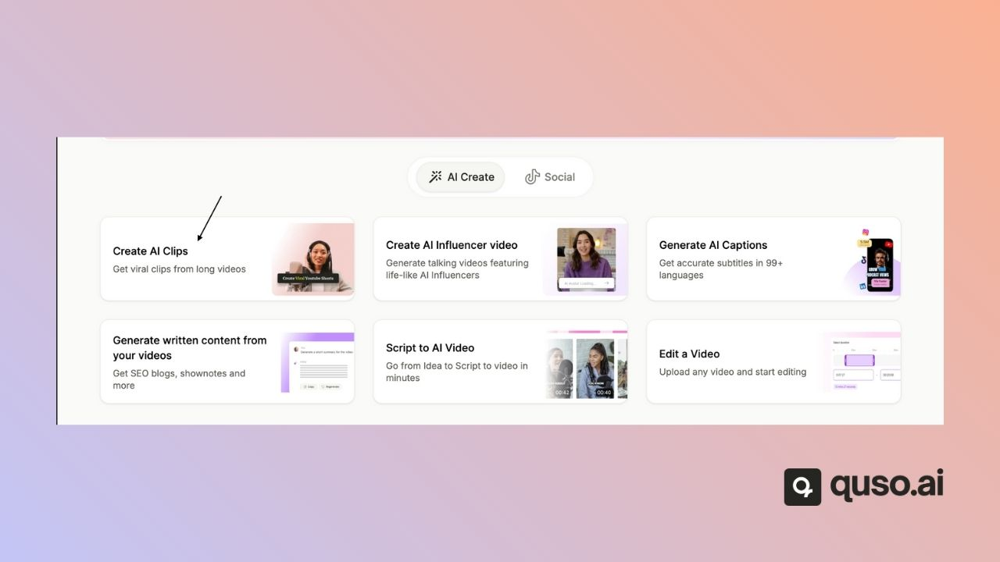
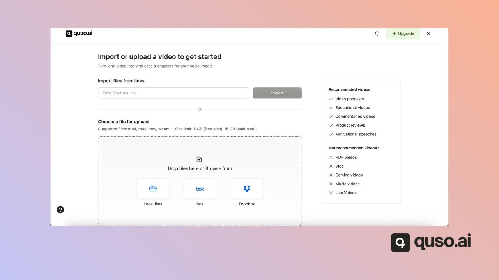
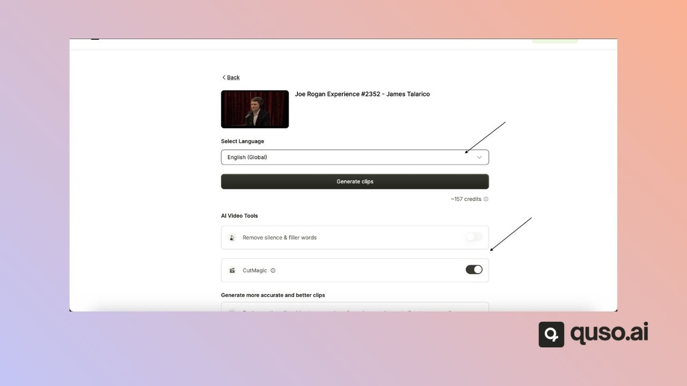
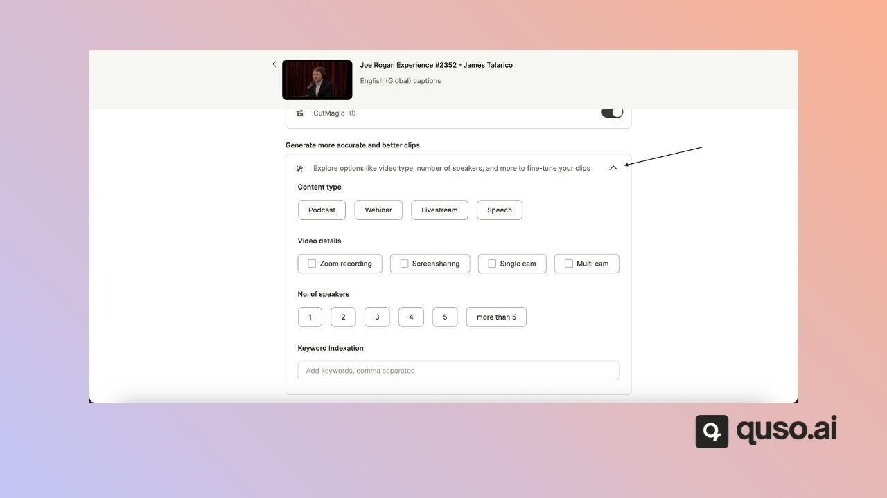
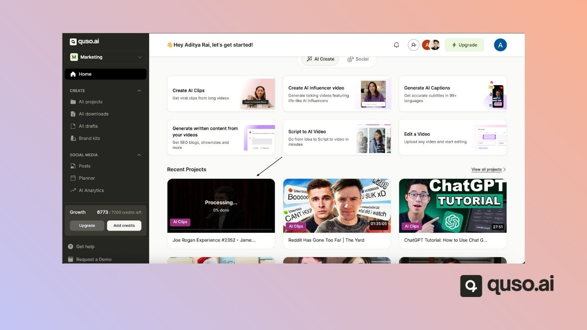

**AI Clips** turns a long video, such as a podcast, webinar, livestream or talk, into short, captioned clips for TikTok, Reels, Shorts and LinkedIn. It is available on every plan, including Free, and costs 1 credit per minute of the video you import. On the home page it appears as **Long to shorts**.

---

## Step 1: Open AI Clips

On the quso.ai home page, click **Long to shorts**. You can also click **New project** and choose **Long to shorts**.

## Step 2: Add your video

Upload a file (MP4, MOV or WebM), pick one from Google Drive or Box, or paste a link from YouTube, Twitch, Vimeo, Zoom, Loom, Dropbox, X, Facebook, LinkedIn or Rumble. See [Video import source](/help/video-import-source).

## Step 3: Set your options

- **Language:** select the language spoken in the video. See [Video languages supported](/help/video-languages-supported).
- **Processing timeframe:** optionally trim the start and end so only part of the video is processed.
- **AI tools:** switch on [CutMagic](/help/what-is-cutmagic), [filler word removal](/help/editor/filler-word-and-silence-removal) and [AI Headline](/help/editor/ai-headline).

  
- **Video details (optional):** tell quso.ai the content type (Podcast, Webinar, Livestream or Speech), the setup (Zoom recording, screen share, single camera or multi-camera), the number of speakers, and keywords you want clips about. These help the AI pick better moments.

  

The number of credits the video will use is shown before you start.

## Step 4: Generate your clips

Click **Generate Clips**. You can follow the progress, step by step, on the home page.

## Step 5: Review, edit and publish

When processing is done, open the project to see your clips ranked by [virality score](/help/virality-scrore). From there you can:

- Edit a clip's captions, layout and branding in the [editor](/help/editor-faq)
- Make a [custom clip](/help/custom-clip-transcript) the AI didn't pick
- Download clips, or publish them to your social accounts

<Tip>
  If a project fails while processing, the credits it used are refunded automatically.
</Tip>

---

## FAQ

<AccordionGroup>
  <Accordion title="How long does AI Clips take?">
    It depends on the video's length. You can leave the page while it works; the project shows its progress on the home page.
  </Accordion>
  <Accordion title="How many clips will I get?">
    It depends on the video's length and how much speech it has. See [How many clips can I get?](/help/how-many-clips).
  </Accordion>
  <Accordion title="Can I choose the clip length?">
    Not on the import screen. AI clips are usually about 20 to 65 seconds. To make a clip of any length, create a [custom clip](/help/custom-clip-timestamp).
  </Accordion>
</AccordionGroup>

---

### Need Help?

If you run into any issues or have questions, our support team at [help@quso.ai](mailto:help@quso.ai) is just a message away.
