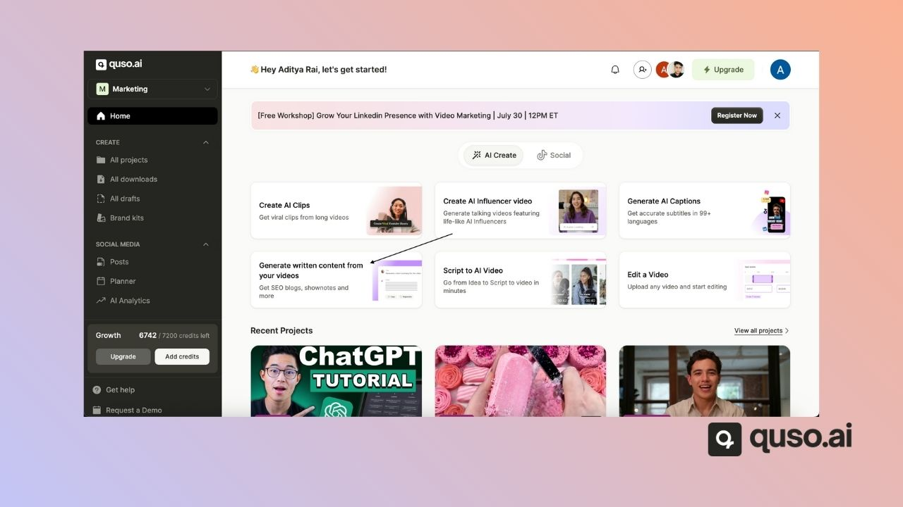
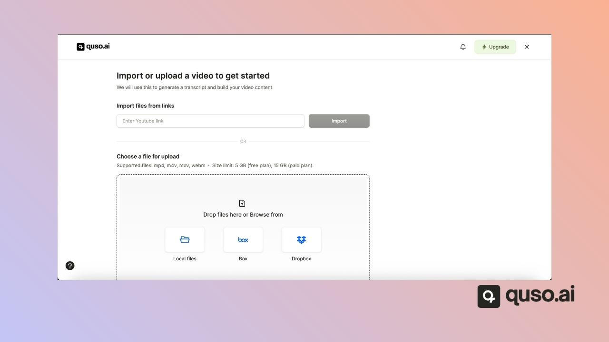
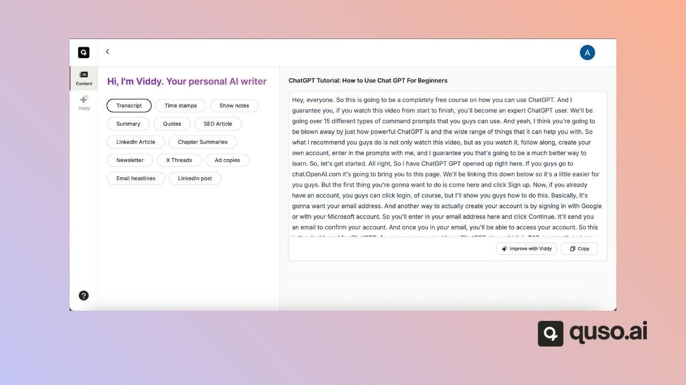
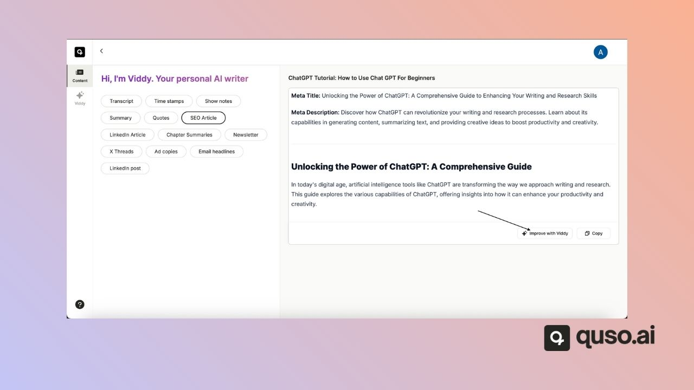
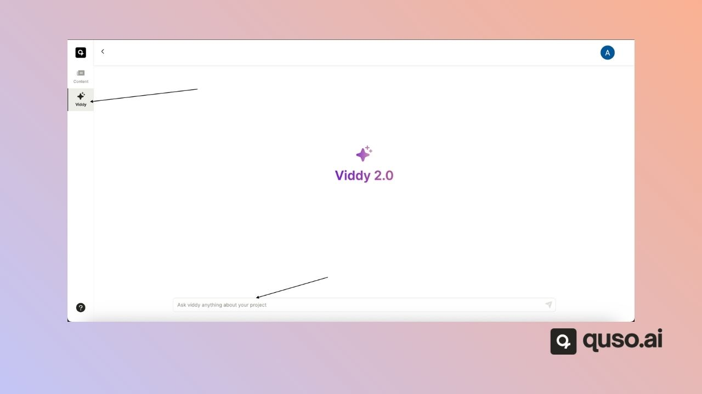

**AI Writer** turns a video or audio recording into ready-to-publish text: a transcript, timestamps, show notes, a summary, quotes, an SEO article, a LinkedIn article or post, chapter summaries, a newsletter, X threads, ad copy and email headlines. It uses 1 credit per minute of the recording and accepts MP4, MOV and WebM video plus MP3, WAV and AAC audio. You can also chat with your video using **Viddy**, on the Essential and Growth plans.

Here's how to use it step by step:

## ✅ Step 1: Upload or Select a Video

To get started, either:

- Click **AI Writer** ("Get SEO blogs, Shownotes and more") on the home page.

  
- **Upload the new video**

  

## 🧠 Step 2: View the Transcript

quso.ai automatically writes content from your video. Pick an output from the **Content** list on the left:

- Transcript and Time stamps
- Show notes, Summary and Quotes
- SEO Article and LinkedIn Article
- Chapter Summaries and Newsletter
- X Threads, LinkedIn post, Ad copies and Email headlines

Each output opens in an editable text box.

## ✨ Step 3: Click “Improve with Viddy 2.0”

To supercharge your content, click the **"Improve with Viddy 2.0"** button. This brings quso.ai’s AI assistant, **Viddy**, into the workflow — allowing you to generate and refine content directly by entering the prompts to improve on the existing article.

## 🛠 Step 4: Edit, Refine, or Revert

Once you’ve generated content:

- You can **edit or tweak** the output directly
- Click **“Improve with Viddy”** again to get a revised version
- Use **“Revert Changes”** if you'd like to go back to your original transcript

## 💬 Step 5: Enter a Prompt for Viddy

Open **Viddy** in the left menu to type your own prompts. Viddy is on the Essential and Growth plans.

Use a natural-language prompt to ask the AI for specific content. Examples:

- _“Write a LinkedIn post from this video.”_
- _“Summarize the key takeaways in 3 bullet points.”_
- _“Turn this into a blog intro.”_
- _“Generate a YouTube description.”_

AI Writer will respond instantly with contextual content based on the transcript.

## 📥 Step 6: Copy or Schedule the Output

When you're happy with the result, you can:

- **Copy** the text to use on other platforms
- Or paste it into a post when you [publish your clips](/help/how-to-bulk-publish)

## 🎯 Use Cases for AI Writer

- Social captions for TikTok, Instagram, LinkedIn, or YouTube
- Blog posts based on webinar recordings or podcast episodes
- Email newsletters or product announcements
- Video descriptions or titles
- Summaries and show notes

## 💡 Final Thoughts

**AI Writer** makes turning video into written content fast, intuitive, and scalable — no copy-pasting between tools, and no starting from scratch. Whether you're repurposing a webinar or drafting a social caption from a podcast, AI Writer keeps you focused on publishing, not formatting.

---

### Need Help?

If you run into any issues or have questions, our support team at [help@quso.ai](mailto:help@quso.ai) is just a message away.
