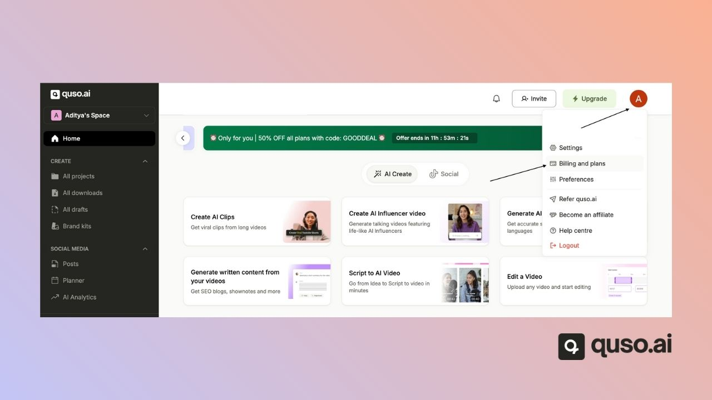
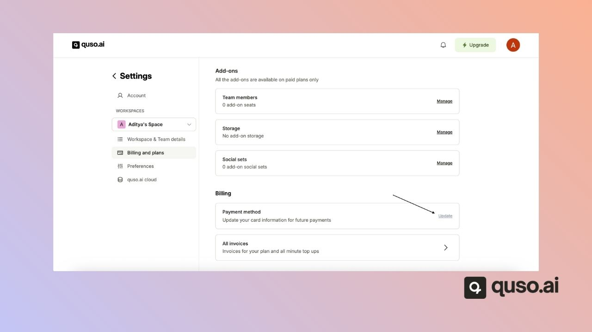

quso.ai processes all subscription payments through **Paddle**, our payment provider and merchant of record. You are billed automatically on your chosen cycle, monthly or yearly, using the payment method you saved at checkout. The Free plan needs no payment details.

---

## How are subscription payments processed?

When you subscribe, Paddle's secure checkout charges your payment method and renews your plan automatically at the end of each billing period. Paddle also issues your invoices and handles taxes such as VAT and GST for your country.

The currency is set from your location, and the payment methods available at checkout depend on your country.

---

## Do I need a credit card to try quso.ai?

No. The Free plan needs no card. You can sign up and start making clips right away with 75 free credits a month. When you need more credits or features, upgrade to a paid plan. See [Subscription plans](/help/subscription-plans).

---

## Update your payment method

Only the **workspace owner** can change billing details.

**Step 1:** Go to **Settings → Billing & Plans**.

**Step 2:** Scroll down to find the **Update payment method** option.

Changes apply to your next payment. You can also ask [help@quso.ai](mailto:help@quso.ai) for help.

---

## FAQ

<AccordionGroup>
  <Accordion title="Can I change my billing currency?">
    Not in the app. quso.ai sets the currency from your location. Email [help@quso.ai](mailto:help@quso.ai) if you have a region-specific issue.
  </Accordion>
  <Accordion title="Where are my invoices?">
    In **Settings → Billing & Plans**, under invoices. See [Download invoice](/help/download-invoice).
  </Accordion>
  <Accordion title="Can I get a refund?">
    Subscription payments are generally non-refundable. If something went wrong, email [help@quso.ai](mailto:help@quso.ai) and the team will look at your case.
  </Accordion>
</AccordionGroup>

---

### Need Help?

If you run into any issues or have questions, our support team at [help@quso.ai](mailto:help@quso.ai) is just a message away.
