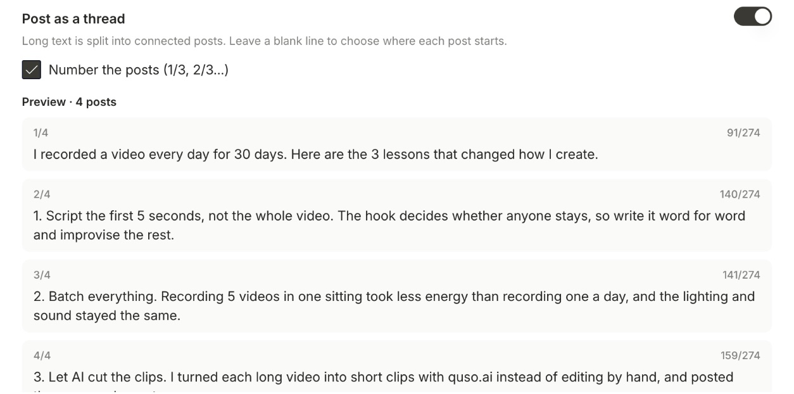

When your text is too long for one post on **X** or **Threads**, quso.ai can split it into a **thread** of connected posts and publish them in order.

<Note>
  Threads are available on plans that include social publishing, such as **Essential** and **Growth**.
</Note>

---

## Post a thread

### Step 1: Write your text

Create a post and select your X and/or Threads account. Write your text in the **X** or **Threads** tab.

<Tip>
  Leave a **blank line** where you want a new post to start. quso.ai also splits any part that's still too long, keeping whole sentences together where they fit.
</Tip>

### Step 2: Turn on Post as a thread

Turn on **Post as a thread**. If your text is already over the limit, click **Turn into a thread** under the character count.

### Step 3: Number the posts (optional)

Tick **Number the posts (1/3, 2/3…)** to add the numbering to the end of each post.

### Step 4: Check the preview

The preview shows every post with its number and length, so you can see exactly how the thread will read.

### Step 5: Publish or schedule

Click **Publish Now** or **Schedule**. The posts go out in order as one connected thread.

---

## Limits

| | X | Threads |
|---|---|---|
| Characters per post | 280 | 500 |
| Posts per thread | up to 25 | up to 25 |

- Numbering takes a few characters from each post, so numbered posts hold slightly less text.
- On X, a link counts as 23 characters and emoji count as 2.
- **Photos and video go on the first post** of the thread.

---

### Need Help?

If you run into any issues or have questions, our support team at [help@quso.ai](mailto:help@quso.ai) is just a message away.
