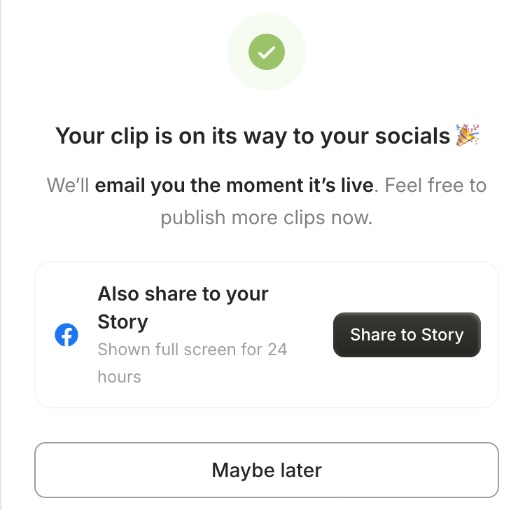
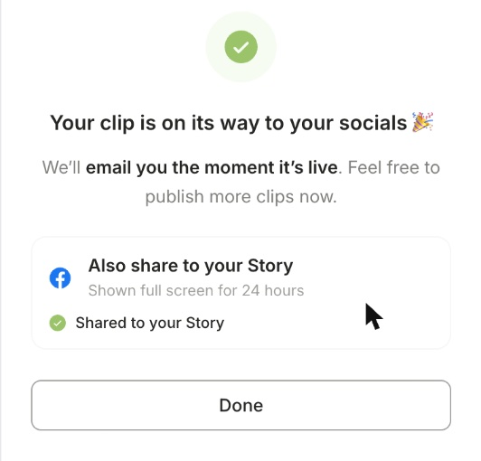

You can post to your **Instagram Story** and your **Facebook Page Story** straight from quso.ai. A Story shows full screen for **24 hours**.

<Note>
  Stories are available on plans that include social publishing, such as **Essential** and **Growth**.
</Note>

---

## Post a Story

### Step 1: Create a post

Go to **Social Media → Posts**, click **New post**, and select your Instagram and/or Facebook account.

### Step 2: Add one photo or video

Add **one** photo, or **one** video of up to **60 seconds**. Stories can't be text only.

### Step 3: Choose Story

Open the **Instagram** or **Facebook** tab and, under **Post format**, choose **Story**.

### Step 4: Publish or schedule

Click **Publish Now** or **Schedule**. Each network's format is set separately, so you can post a Story on Instagram and a normal post on Facebook from the same composer.

---

## Add a clip you just published to your Story

When you publish a clip to Instagram or Facebook, quso.ai offers to post the same video to your Story too, with no need to export it again.

### Step 1: Publish your clip

Publish a clip to your Instagram and/or Facebook account with **Publish now**, from the share panel or the editor.

### Step 2: Click Share to Story

On the success screen, under **Also share to your Story**, click **Share to Story**.

### Step 3: You're done

You'll see **Shared to your Story**. If your clip is still being prepared, you'll see **Your Story will post when the clip is ready** instead, and the Story goes out on its own as soon as the video is ready.

<Note>
  The Story offer appears for **vertical (9:16)** clips of up to **60 seconds** that you **publish now**. It isn't shown for scheduled posts, landscape or square clips, or when that network already posts the clip as a Story. To add a Story to a scheduled post, choose **Story** in that network's tab when you schedule it (see above).
</Note>

---

## What changes for a Story

- **No caption is shown.** Stories don't display a caption. Your other networks in the same post still get it.
- **One photo or video only**, and videos up to 60 seconds.
- Options that don't apply to Stories are hidden, such as the thumbnail picker, **Show this reel in feed**, auto-resize and **Invite collaborators** on Instagram.

---

## FAQ

<AccordionGroup>
  <Accordion title='It says "An Instagram Story needs one photo or video"'>
    Add a photo or video to the post, or switch **Post format** back to Post or Reel.
  </Accordion>
  <Accordion title='It says "takes one photo or video"'>
    A Story holds a single photo or video. Remove the extra media, or switch the post format back.
  </Accordion>
  <Accordion title="My video is longer than 60 seconds">
    Use a shorter clip for the Story. You can still post the full video as a Reel or post.
  </Accordion>
  <Accordion title="I don't see Also share to your Story after publishing">
    The offer only appears for vertical clips of up to 60 seconds, published now (not scheduled) to Instagram or Facebook, on a plan that includes social publishing. For other clips, post the Story from the composer instead.
  </Accordion>
</AccordionGroup>

---

### Need Help?

If you run into any issues or have questions, our support team at [help@quso.ai](mailto:help@quso.ai) is just a message away.
