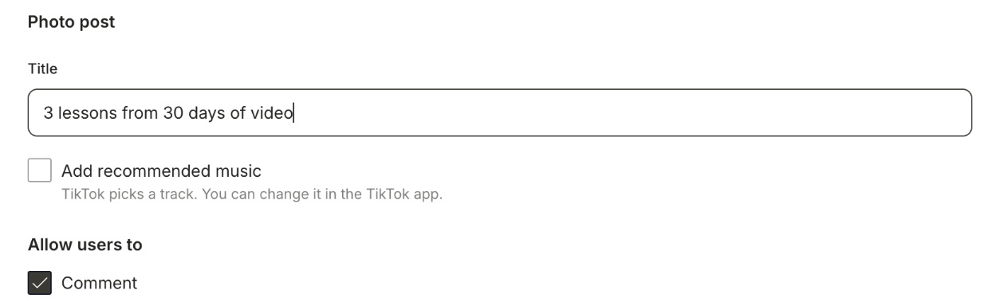

You can post **photos** to TikTok as a swipeable photo post, not just videos. quso.ai makes it a photo post automatically when your TikTok post has images and no video.

<Note>
  TikTok photo posts are available on plans that include social publishing, such as **Essential** and **Growth**.
</Note>

---

## Post photos to TikTok

### Step 1: Create a post with images

Go to **Social Media → Posts**, click **New post**, select your TikTok account, and add **up to 10 images** with **Add Media → Upload images**. Don't add a video: a post is either photos or one video.

### Step 2: Set up the photo post

On the **TikTok** tab, under **Photo post**:

- **Title** (optional): up to **90 characters**, shown above your caption on TikTok.
- **Cover:** tap a photo to make it the cover. The first photo is the cover by default.
- **Add recommended music:** TikTok picks a track for you. You can change it later in the TikTok app.

### Step 3: Publish or schedule

Click **Publish Now** or **Schedule**.

---

## Good to know

- Photo posts can turn **comments** on or off. **Duet** and **Stitch** are for videos only, so they're hidden.
- Photos appear in the order you added them.

---

### Need Help?

If you run into any issues or have questions, our support team at [help@quso.ai](mailto:help@quso.ai) is just a message away.
