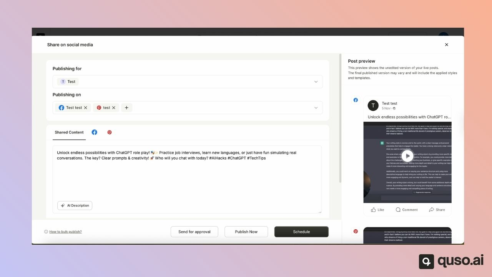
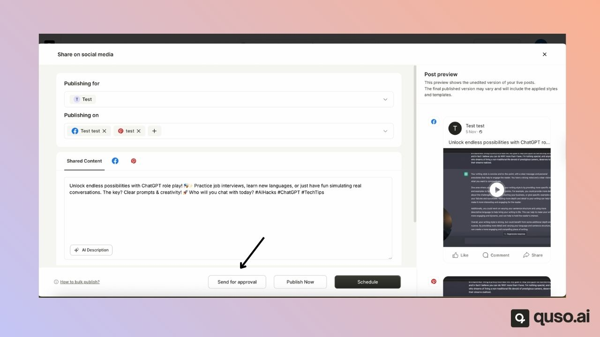
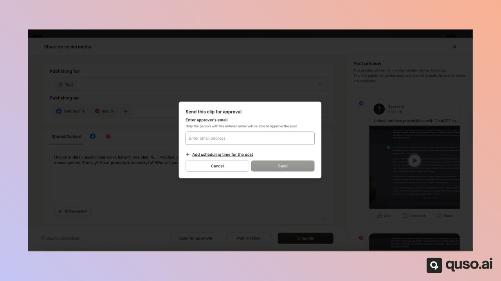
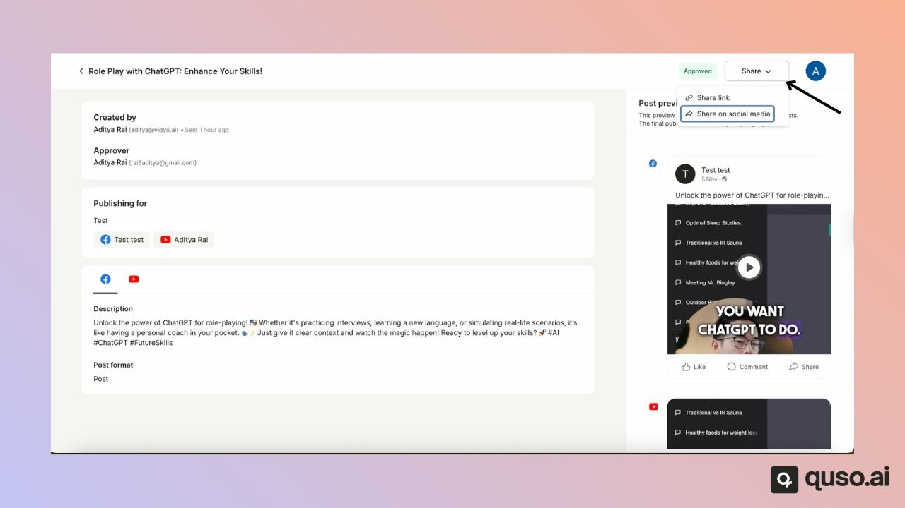

**Send for Approval** lets you get a social media post reviewed before it goes live. You send the post to an approver's email address; they open the link, sign in to quso.ai and approve or reject it. Approved scheduled posts publish automatically at their scheduled time. Approvals need a team workspace, which means at least one team member seat.

---

## 🧩 Prerequisite: Team Workspace Required

To use the **Approval Flow**, you must have a **Team Workspace**.\
This requires purchasing at least **one Team Member seat add-on**.

Once you have a Team Workspace, you can send posts for approval to **any email address**, even if the approver is **not part of your workspace**. You can't approve your own post.

---

## 🧭 How to Send a Post for Approval

### **Step 1: Open the Publishing Page**

- Go to the **Publishing** page for the post you want to send.
- Enter or generate your **post description**.
- Select the **social media platforms** you’d like to publish to.

---

### **Step 2: Send for Approval**

- Click the **Send for Approval** button.

---

### **Step 3: Choose Approval Type**

While sending a post for approval, you can choose one of the following options:

- **Send for Approval only** – Sends the post for review, and you can manually publish it once approved.
- **Add Schedule time and Send for Approval** – Sends the post for approval and automatically publishes it at the selected date and time once approved.

---

### **Step 4: Enter the Approver’s Email**

- Enter the **email address** of the person who will review the post.
- The approver will receive an **email with a direct link** to view the post.

<Note>
  The approver must **sign up or log in** to quso.ai with the same email address that received the link to see and approve the post. A free account is enough.
</Note>

If you have a free seat, you can also tick **Invite this person to this workspace** so the approver joins your team. Without the invite, they can still approve the post but don't join the workspace. You can also copy the review link and share it yourself.

---

## ✅ Approval and Publishing Flow

### **For Scheduled Posts:**

- Once approved, the post will be **automatically scheduled** and **published** at the selected time and date.

### **For Regular Posts:**

- These appear under the **Sent for Approval** tab.
- The **user who created the post** will need to return and publish it manually once approved.

---

### **Post statuses**

A post sent for approval is **In review**, **Approved**, **Rejected** or **Expired**. You can change the approver or reschedule a post while it waits for review.

### **Owner Privileges**

The **workspace owner** always has the option to **publish the post directly**, even without receiving approval.

---

---

### Need Help?

If you run into any issues or have questions, our support team at [help@quso.ai](mailto:help@quso.ai) is just a message away.
