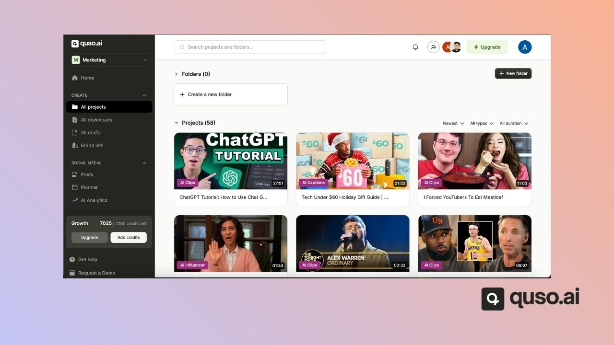
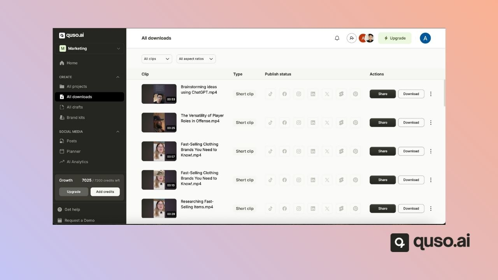
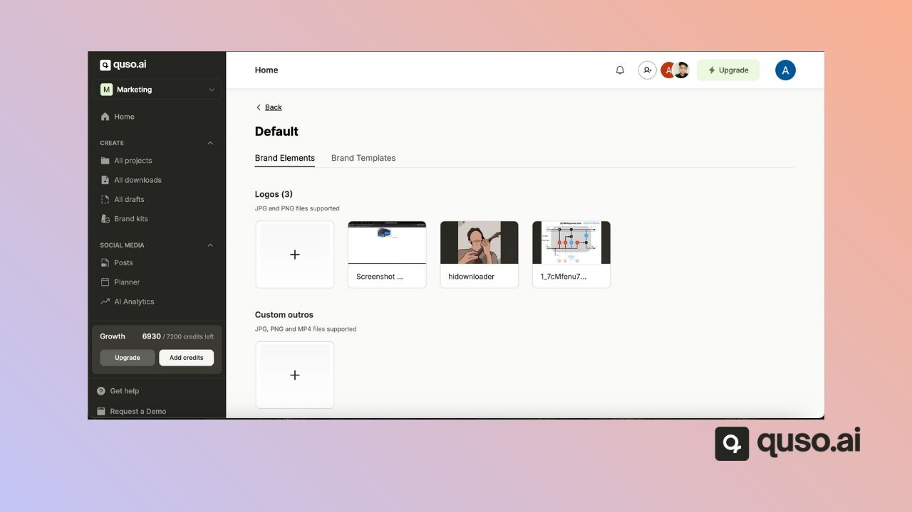
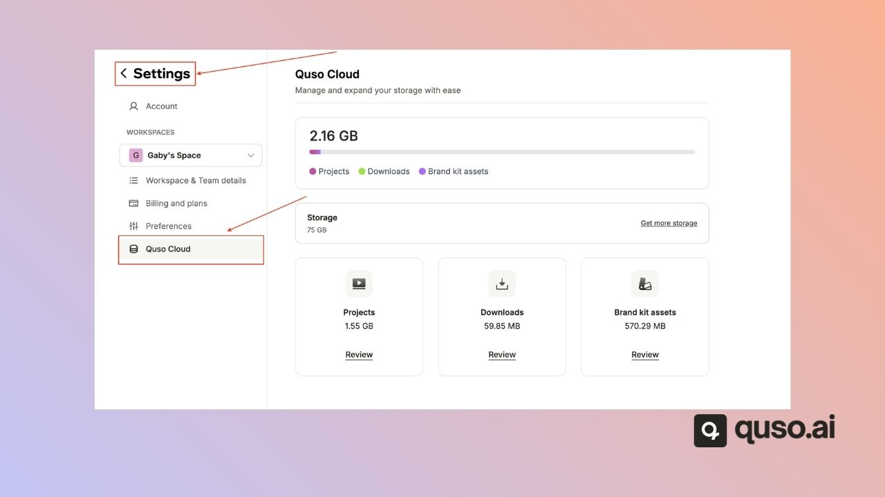

Every quso.ai plan includes cloud storage for your projects, downloads and brand assets: **5 GB on Free, 10 GB on Lite, 25 GB on Essential and 75 GB on Growth**. You can check your usage, delete items and buy extra storage from **Settings → Storage**.

---

## Storage by plan

| Plan | Storage |
|---|---|
| Free | 5 GB. Projects are deleted after 7 days. |
| Lite | 10 GB |
| Plus (mobile) | 10 GB |
| Essential | 25 GB |
| Growth | 75 GB |

Any extra storage you buy is added on top of your plan's storage.

---

## What counts toward storage

Your storage is split into three categories:

1. **Projects:** your uploaded videos and everything made from them.

   

   Deleting a project deletes the uploaded video and all its clips.

2. **Downloads:** the clips you have rendered.

   

   Deleting a download also removes the social media posts made from it.

3. **Brand kit assets:** logos, outros, fonts, images, videos, audio files and backgrounds.

   

   Deleting a brand asset removes it from the editor, your drafts and your brand templates.

---

## Check your storage

Go to **Settings → Storage**. You'll see:

- Your total and used storage, in GB
- How much each category uses

When you run out of storage, a banner appears on the home page.

---

## What happens when you run out of storage

- New projects that finish processing are **locked** until you free up space or add storage.
- You get an email when a project is locked.
- Deleting a locked project refunds the credits it used.

---

## Free up space or add storage

You have two options:

1. **Free up space:** in **Settings → Storage**, open a category, select the items you no longer need and delete them.
2. **Buy extra storage:** add-ons range from **50 GB to 5 TB**, billed monthly, every 6 months or yearly. The price is shown before you buy. Locked projects unlock once the payment goes through.

<Warning>
  Extra storage is removed if you cancel your subscription.
</Warning>

---

## FAQ

<AccordionGroup>
  <Accordion title="How long does quso.ai keep my videos?">
    On paid plans, until you delete them. On the Free plan, projects are deleted after 7 days.
  </Accordion>
  <Accordion title="Does deleting a project give my credits back?">
    Only for projects that were locked because you were out of storage. Failed imports are refunded automatically.
  </Accordion>
</AccordionGroup>

---

### Need Help?

If you run into any issues or have questions, our support team at [help@quso.ai](mailto:help@quso.ai) is just a message away.
