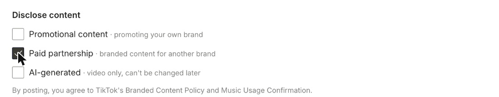

On the **TikTok** tab you can send a post to your **TikTok drafts** instead of publishing it, and add TikTok's **disclosure labels** to posts you publish.

---

## Send to TikTok drafts

Turn on **Send to TikTok drafts** to send the video to your TikTok inbox instead of posting it. Open TikTok to finish it, for example to add a trending sound, then publish it from the app.

- Drafts don't take a first comment.
- Disclosure labels are hidden while drafts are on: set them in the TikTok app before you publish.

---

## Add disclosure labels

Under **Disclose content**, tick what applies to the post:

- **Promotional content:** you're promoting your own brand, product or business.
- **Paid partnership:** branded content you made for another brand.
- **AI-generated:** the content was made or substantially edited with AI. **Videos only**, and it can't be changed after posting.

By posting, you agree to TikTok's Music Usage Confirmation, and with **Paid partnership**, to TikTok's Branded Content Policy as well.

---

### Need Help?

If you run into any issues or have questions, our support team at [help@quso.ai](mailto:help@quso.ai) is just a message away.
