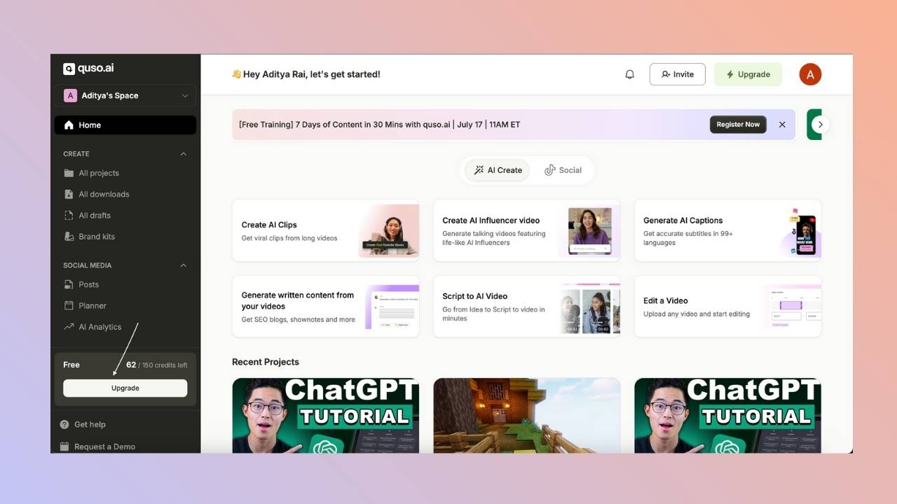
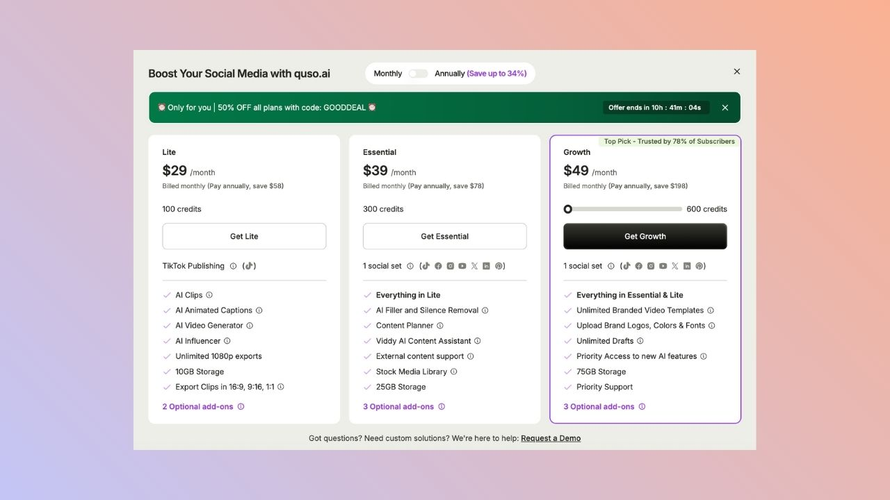
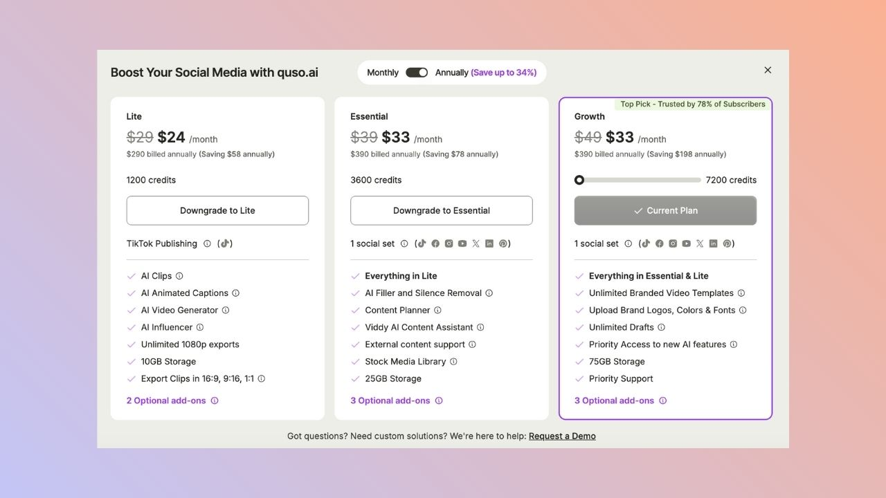

You can move between quso.ai plans, or between monthly and annual billing, at any time from the **Upgrade** button. Only the workspace owner can change the plan. Upgrades take effect immediately, and quso.ai shows you what you will be charged before you confirm.

---

## Upgrade your plan

1. Click **Upgrade** at the bottom left of the home page.

2. **Choose the plan** you want. You can also switch between monthly and annual billing here.

3. **Confirm the payment.** Your new plan and its credits are active as soon as the payment goes through.

When you upgrade in the middle of a billing period, you are charged a **prorated** amount for the rest of that period.

---

## Downgrade your plan

1. Click **Upgrade** at the bottom left of the home page.
2. **Select the lower plan** you want to move to.

   
3. **Confirm the change.**

<Tip>
  If you downgrade before your billing period ends, the unused part of your current plan is kept as a **credit on your account**. It is applied automatically to your next bill. The amount depends on how much time was left on your plan.
</Tip>

### Monthly credit plans

If you are on a monthly credit plan (for example 400 credits a month):

- Moving to a **higher** credit tier charges the new price right away, with no proration.
- Moving to a **lower** tier takes effect at your next renewal, and nothing is charged now.
- To move from yearly to monthly billing, email [help@quso.ai](mailto:help@quso.ai).

---

## Cancel your plan

1. Go to **Settings → Billing & Plans**.
2. Click **Cancel Plan** and follow the steps.

Your plan stays active until the end of the current billing period. After that, your account moves to the Free plan, and projects that are older than 7 days are deleted. Extra storage you bought is removed when you cancel. You can reactivate before the period ends to undo a scheduled cancellation.

---

## FAQ

<AccordionGroup>
  <Accordion title="Do I lose my credits when I upgrade?">
    No. You get the new plan's credits as soon as the upgrade goes through.
  </Accordion>
  <Accordion title="When does a downgrade take effect?">
    Right away on monthly and annual plans, with the unused time credited to your next bill. On monthly credit plans, a downgrade starts at your next renewal.
  </Accordion>
  <Accordion title="Can a team member change the plan?">
    No. Only the workspace owner can change the plan or buy add-ons. Members see a message asking them to contact the owner.
  </Accordion>
</AccordionGroup>

---

### Need Help?

If you run into any issues or have questions, our support team at [help@quso.ai](mailto:help@quso.ai) is just a message away.
