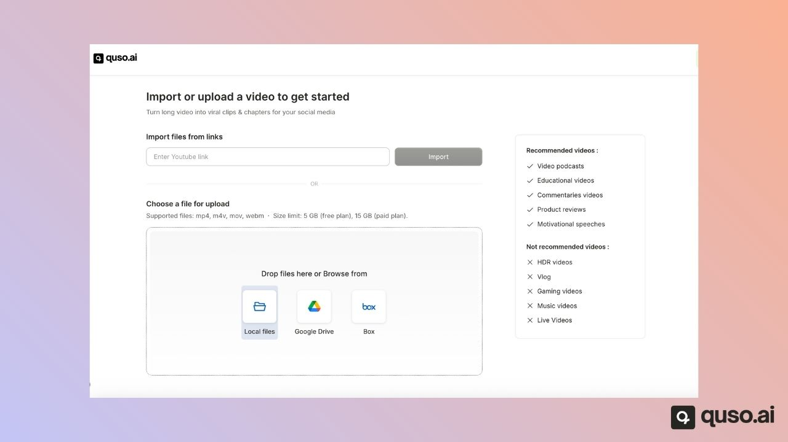
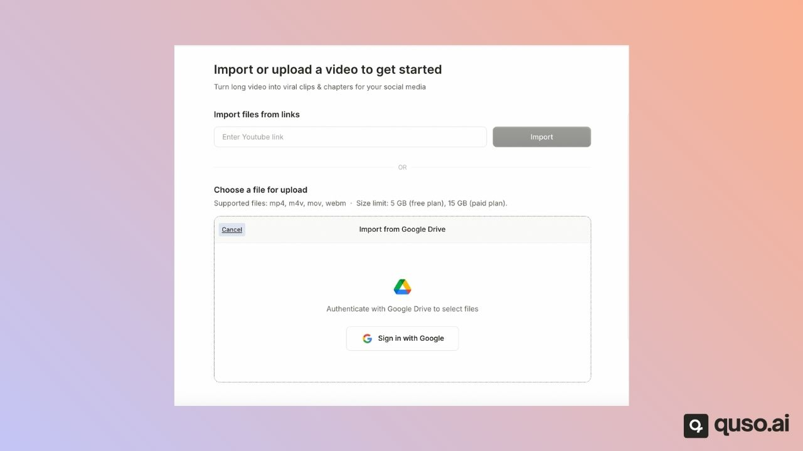

You can bring a video into quso.ai in three ways: **paste a link** from one of 11 supported sites, **pick a file from Google Drive or Box**, or **upload a file** from your device. Every import source works on every plan, on desktop and in your phone's browser.

---

## Supported link sources

Paste a link to a single video from any of these sites:

| Source | What works |
|---|---|
| **YouTube** | Public or unlisted videos and Shorts. Private videos, channels, playlists and search pages don't work. |
| **Twitch** | VODs (past broadcasts) and clips. Channel pages and live streams don't work. |
| **Vimeo** | Public videos |
| **Zoom** | Cloud recording share links. If the recording needs a passcode, quso.ai tells you. |
| **Loom** | Shared videos |
| **Google Drive** | Links to a single video shared with "Anyone with the link". Folders don't work. |
| **Dropbox** | Shared video links |
| **X (Twitter)** | Posts with a video, on x.com or twitter.com |
| **Facebook** | Public videos, including fb.watch links |
| **LinkedIn** | Posts with a video |
| **Rumble** | Public videos |

Live streams can't be imported while they are live. Wait until the broadcast has ended and import the recording.

<Note>
  Links from Instagram, TikTok, Reddit, Pinterest, Snapchat, Dailymotion, Spotify, Kick and Riverside are **not supported**. Download the video and upload the file instead.
</Note>

---

## Import from Google Drive or Box

On the upload screen, choose **Google Drive** or **Box**, sign in, allow quso.ai to read your files, and pick the video.

---

## Upload a file from your device

Drag a file onto the upload screen or browse to it.

**Supported formats:** MP4, MOV and WebM. AI Writer also accepts MP3, WAV and AAC audio files.

**Maximum file size:**

| Plan | AI Clips | AI Captions and other projects |
|---|---|---|
| Free | 5 GB | 5 GB |
| Paid plans | 25 GB | 15 GB |

Large uploads resume automatically if your connection drops for a moment. If your file is bigger than the limit, compress or trim it first.

---

## How long can a video be?

The longest video you can import is limited by the credits you have left, since 1 credit covers 1 minute. On the Free plan, your first import can be up to 150 minutes. Links from Twitch, Vimeo, Loom, Dropbox, X, Facebook, LinkedIn and Rumble can be up to **4 hours** long. See [Video length & types](/help/video-length-types).

---

## FAQ

<AccordionGroup>
  <Accordion title="Can I import a Twitch VOD into quso.ai?">
    Yes. Paste the link to the past broadcast (VOD) or to a Twitch clip. A link to a channel page, or to a stream that is still live, won't work.
  </Accordion>
  <Accordion title="Why does my YouTube link say it is not supported?">
    The link must point to one public or unlisted video. Channel, playlist and search links are rejected, and private videos can't be read.
  </Accordion>
  <Accordion title="Can I import an MKV or AVI file?">
    Not directly. Convert it to MP4, MOV or WebM and upload it again.
  </Accordion>
  <Accordion title="Can I import a podcast audio file?">
    AI Writer accepts MP3, WAV and AAC. AI Clips and AI Captions need a video file.
  </Accordion>
</AccordionGroup>

---

### Need Help?

If you run into any issues or have questions, our support team at [help@quso.ai](mailto:help@quso.ai) is just a message away.
