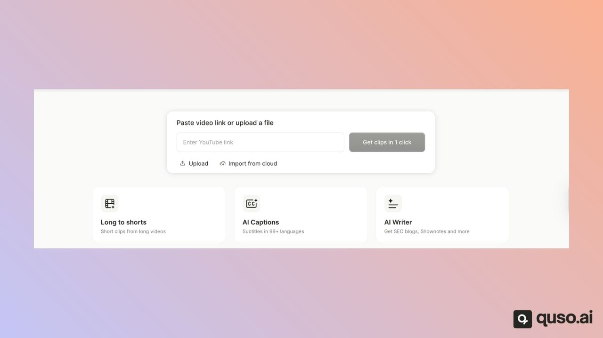
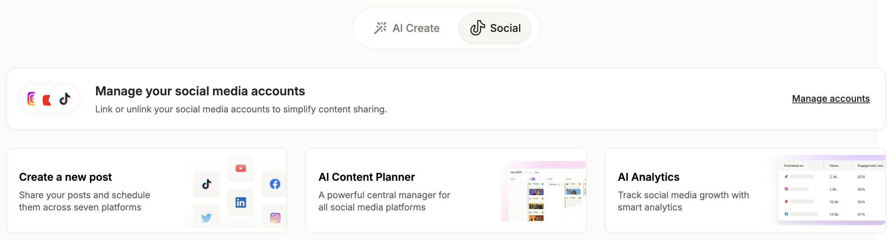

**quso.ai** (formerly Vidyo.ai) is an AI video and social media tool for creators, marketers, podcasters and agencies. It turns long videos into short, captioned clips, adds subtitles in 99 languages, writes posts from your videos, and publishes or schedules them to your social accounts. You can start on the Free plan with 75 credits a month and no credit card.

---

## Create from your videos

This is the home page you see when you log in:

<Frame>
  
</Frame>

<AccordionGroup>
  <Accordion title="Long to shorts (AI Clips)" defaultOpen>
    Import a long video and get dozens of short, captioned clips in one go, each with a virality score. Works in 19 languages.

    **Best for:** podcasts, webinars, livestreams, interviews and Zoom calls.

    [Learn more about AI Clips](/help/what-is-ai-clips)
  </Accordion>

  <Accordion title="AI Captions">
    Add animated captions to a whole video in 99 languages, then style them with fonts, colors, emojis and animations.

    **Best for:** captioning a finished video, Reel or ad.

    [Learn more about AI Captions](/help/ai-captions)
  </Accordion>

  <Accordion title="AI Writer">
    Turn a video or audio file into show notes, summaries, blog posts, newsletters and social posts. Chat with your video using Viddy.

    **Best for:** written content from your recordings.

    [Learn more about AI Writer](/help/how-to-use-ai-writer)
  </Accordion>
</AccordionGroup>

## Publish to social media

<AccordionGroup>
  <Accordion title="Create and schedule posts" defaultOpen>
    Publish or schedule clips and your own media to TikTok, Instagram, YouTube, Facebook, LinkedIn, X, Pinterest, Threads, Bluesky, Telegram, Reddit and Snapchat. Organize accounts by brand or client with [Social Sets](/help/what-is-a-social-set). The Free and Lite plans publish to TikTok.

    [Connect your social accounts](/help/add-social-media-accounts)
  </Accordion>

  <Accordion title="Content planner">
    Plan your posts on a weekly calendar and auto-fill empty slots from your files. On Essential and Growth.

    [Learn more](/help/content-planner)
  </Accordion>

  <Accordion title="Social media analytics">
    See followers, impressions, engagement and AI insights for your connected accounts, with a Social Score. On Essential and Growth.

    [Learn more](/help/social-media-analytics)
  </Accordion>
</AccordionGroup>

## Next steps

<CardGroup cols={2}>
  <Card title="Set up your account" icon="rocket" href="/help/setup-account">
    Brand kit, social accounts and team in three steps.
  </Card>
  <Card title="How credits work" icon="coins" href="/help/how-credits-work">
    1 credit = 1 minute of video.
  </Card>
  <Card title="Subscription plans" icon="tags" href="/help/subscription-plans">
    Free, Lite, Essential and Growth compared.
  </Card>
  <Card title="General FAQs" icon="circle-question" href="/help/general-faq">
    Answers to common questions.
  </Card>
</CardGroup>

---

### Need Help?

If you run into any issues or have questions, our support team at [help@quso.ai](mailto:help@quso.ai) is just a message away.
