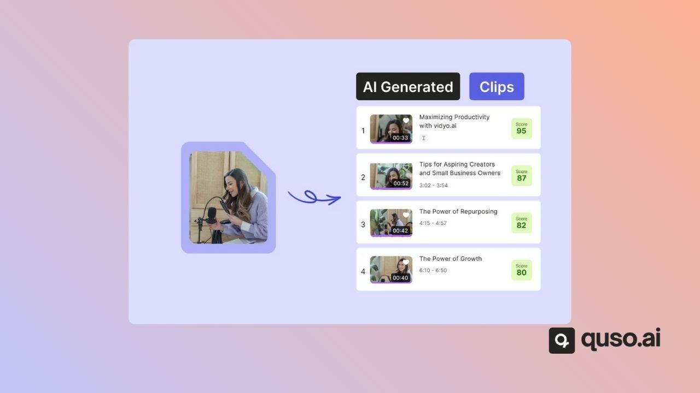
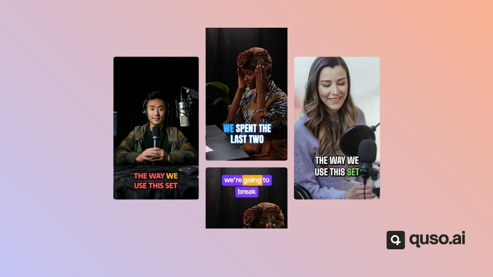
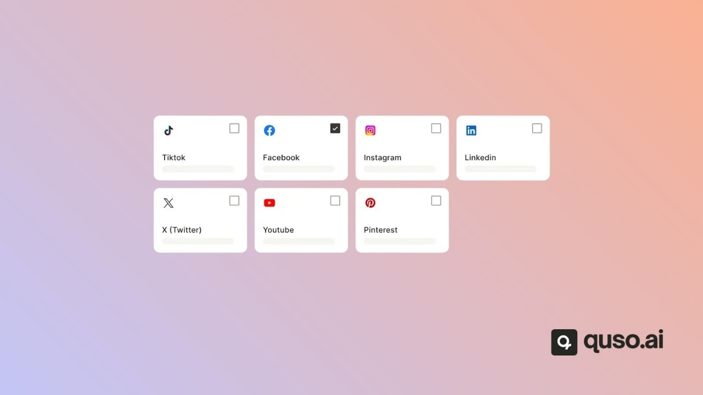

**AI Clips** is quso.ai's AI clip generator. It watches a long video, such as a podcast, webinar, livestream or interview, finds the moments most likely to perform on social media, and turns them into short, captioned clips ready for TikTok, Instagram Reels, YouTube Shorts and LinkedIn. It is included on every plan, including Free, and uses 1 credit per minute of imported video.

<iframe
  src="https://www.youtube.com/embed/39T-ecL5Xec"
  title="YouTube video player"
  frameBorder="0"
  className="w-full aspect-video rounded-xl"
  allow="accelerometer; autoplay; clipboard-write; encrypted-media; gyroscope; picture-in-picture; web-share"
  allowFullScreen
/>

---

## What you get from one video

- **Short clips**, usually about 20 to 65 seconds each, with animated captions.
- **Chapters**: longer 16:9 sections of the video, for YouTube or long-form use.
- A **virality score** out of 100 on each clip, with grades for Trends, Hook & Flow, Engagement and Shareability (paid plans). See [Virality score](/help/virality-scrore).
- An editable, word-level **transcript** you can make [custom clips](/help/custom-clip-transcript) from.

---

## How AI Clips picks moments

AI Clips reads the transcript of your video and looks for natural hooks, complete thoughts, emotional peaks and useful takeaways. It removes near-duplicates, ranks the clips and gives each one a score. Telling it the content type, number of speakers and keywords on the import screen helps it choose better moments.

---

## Customize every clip

- **Aspect ratios:** 9:16, 1:1 and 16:9, plus a 9:16 split layout.
- **Templates and brand kits** for captions, fonts, colors and logos. See [Brand kit & templates](/help/brand-kit-templates).
- **[CutMagic](/help/what-is-cutmagic)** reframes multi-camera and screen-share video so the speaker stays in frame.
- **[AI Headline](/help/editor/ai-headline)** opens each clip with a short headline.
- **[Filler word & silence removal](/help/editor/filler-word-and-silence-removal)** on Essential and Growth.

---

## Publish from the same place

Download your clips, or publish and schedule them to your connected social accounts. The Free and Lite plans publish to TikTok; Essential and Growth schedule to 12 networks. See [Subscription plans](/help/subscription-plans).

---

## FAQ

<AccordionGroup>
  <Accordion title="Is AI Clips free?">
    Yes. AI Clips is on the Free plan, which gives 75 credits a month. Free exports are 720p with a watermark; paid plans export 1080p with no watermark.
  </Accordion>
  <Accordion title="Which languages does AI Clips support?">
    19 languages, including 4 English variants. See [Video languages supported](/help/video-languages-supported).
  </Accordion>
  <Accordion title="Does AI Clips work on gameplay or music videos?">
    Only if there is speech. AI Clips finds moments from what is said, so videos without speech produce few or no clips.
  </Accordion>
</AccordionGroup>

<Card title="How to use AI Clips" icon="play" href="/help/how-to-use-ai-clips">
  Step-by-step guide to your first AI Clips project.
</Card>

---

### Need Help?

If you run into any issues or have questions, our support team at [help@quso.ai](mailto:help@quso.ai) is just a message away.
