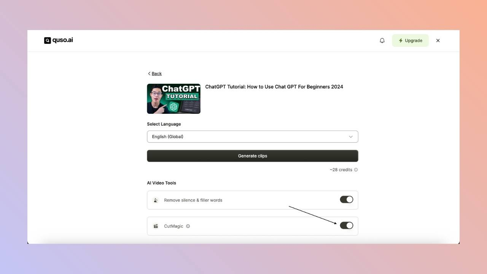

**CutMagic** is quso.ai's automatic reframing tool. It detects every scene change, face and screen share in your video and picks a layout for each scene, so the person speaking stays in frame when a landscape video becomes a vertical clip. It is made for podcasts, interviews, panels, webinars and other multi-camera or screen-share videos. CutMagic is included on paid plans (Lite, Essential, Growth and Plus).

<Note>
  On the Free plan, CutMagic is not included. In some countries, free accounts get CutMagic on their first 3 videos.
</Note>

---

## How to turn on CutMagic

Turn on CutMagic on the import screen, under the AI tools, before you click **Generate Clips**. It is on by default for paid plans.

<Warning>
  CutMagic can't be added to a video after it has been processed. If you forgot to turn it on, import the video again with CutMagic on.
</Warning>

---

## What does CutMagic do?

- **Detects scenes:** marks every scene change so you can adjust or remove cuts quickly.
- **Handles multiple cameras:** recognizes different camera angles and switches between them, which is ideal for interviews and events.
- **Picks a layout per scene:** chooses from 9 layouts, such as single speaker, two speakers, or screen plus speaker. See [CutMagic layouts](/help/new-cut-magic).
- **Places subtitles** where they don't cover faces or screens.

---

## FAQ

<AccordionGroup>
  <Accordion title="Which aspect ratio does CutMagic work in?">
    CutMagic layouts are made for 9:16 portrait clips.
  </Accordion>
  <Accordion title="Can I change the layout CutMagic chose?">
    Yes. In the editor's **CutMagic** tab, pick a different layout for any scene, crop or reframe elements, or add a new scene cut. See [CutMagic layouts](/help/new-cut-magic) and [How to use the timeline with CutMagic](/help/editor/how-to-use-timeline-with-CutMagic).
  </Accordion>
  <Accordion title="Does CutMagic use extra credits?">
    No. The credit cost is the same with or without CutMagic.
  </Accordion>
</AccordionGroup>

---

### Need Help?

If you run into any issues or have questions, our support team at [help@quso.ai](mailto:help@quso.ai) is just a message away.
