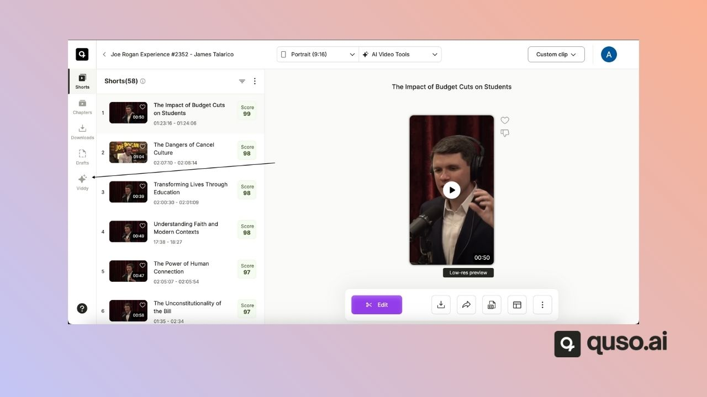
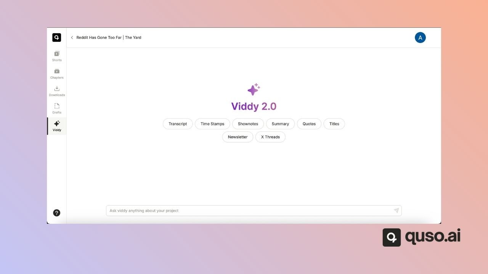

**Viddy** is the AI content assistant inside quso.ai's **AI Writer**. You chat with it about your video, and it writes social posts, summaries, show notes, titles, newsletters and more, using the video's transcript as context. Viddy is included on the **Essential** and **Growth** plans.

## 🤖 What Is Viddy

Think of Viddy as ChatGPT for your video, trained to write social media content. It reads the transcript of your project, so every answer is based on what was actually said.

<iframe width="560" height="315" src="https://www.youtube.com/embed/yis3V0kPWZs?si=BZSRRkeUxuPznp5d" title="YouTube video player" frameborder="0" allow="accelerometer; autoplay; clipboard-write; encrypted-media; gyroscope; picture-in-picture; web-share" referrerpolicy="strict-origin-when-cross-origin" allowfullscreen />

## 🧠 What Can Viddy Do?

- **Transcript Analysis**\
  Viddy automatically scans your video transcript and identifies contextually rich segments — such as hooks, insights, key takeaways, and quotable moments.
- **Prompt-Based Content Creation**\
  Just ask\! Use natural prompts like:
  - _“Write a LinkedIn post from this video.”_
  - _“Summarize the key insights in 3 bullet points.”_
  - _“Create a blog intro based on this section.”_\
    Viddy responds with contextual, ready-to-use content.
- **Content Formats You Can Generate**
  - Social media posts (LinkedIn, Twitter/X, Instagram)
  - Video summaries
  - YouTube descriptions
  - Newsletters
  - Blog outlines or full drafts
  - Clip titles or viral hooks
  - SEO content ideas
- **Instant Editing & Rewrites**\
  Want to change the tone, tighten the copy, or simplify the language? Viddy can rewrite the generated output instantly—just prompt it again or press **“Improve with Viddy”**.

## ✍️ Why Use Viddy?

- 🚀 **Create Faster** – Go from raw video to publish-ready copy in minutes.
- 💡 **Repurpose Efficiently** – Turn every video into multiple content pieces.
- 🔍 **Find the Gold** – Viddy highlights what matters most, so you don’t have to dig through footage.
- ✨ **Stay Consistent** – Maintain your brand’s voice and tone with customizable prompts.

## 🛠 How to Use Viddy

1. Open an **AI Writer** project and click **Viddy** in the side menu.

   
2. Type a prompt, like “Generate a blog outline” or “Draft LinkedIn captions”, or pick a suggestion: Transcript, Time Stamps, Shownotes, Summary, Quotes, Titles, Newsletter or X Threads.

   
3. Review and edit the generated content. Use **“Revert changes”** if needed.
4. Use the **Copy** button to paste the content wherever you need it.

## ✅ Final Thoughts

Viddy is more than a writing assistant — it's your content strategist, copywriter, and repurposing engine in one. Whether you're building a personal brand or scaling a content team, Viddy helps you publish smarter, not harder.

Ready to try it? Head to your dashboard and start prompting.

---

### Need Help?

If you run into any issues or have questions, our support team at [help@quso.ai](mailto:help@quso.ai) is just a message away.
