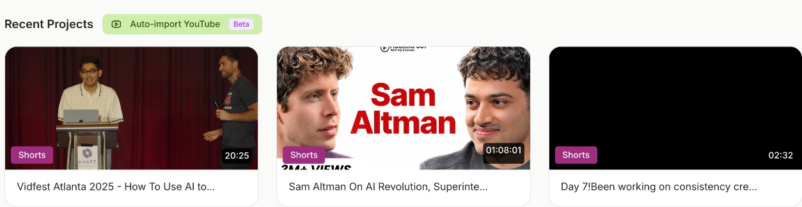
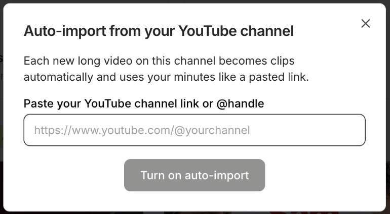

**YouTube auto-import** watches your YouTube channel. Every time you upload a new long video, quso.ai imports it and makes clips automatically, as if you had pasted the link yourself. No more copying links after each upload.

<Note>
  YouTube auto-import is in **Beta** and available on **paid plans**. Each imported video uses your minutes like a pasted link.
</Note>

---

## Turn on auto-import

### Step 1: Find the button on Home

On the **Home** page, click **Auto-import YouTube** next to **Recent Projects**.

<Tip>
  The button appears once you have at least one project. Import any video first if you don't see it.
</Tip>

### Step 2: Paste your channel

Paste your channel link or **@handle**, for example `https://www.youtube.com/@yourchannel`, `youtube.com/channel/…`, or just `@yourchannel`.

### Step 3: Turn it on

Click **Turn on auto-import**. The button now reads **Auto-import on:** followed by your channel's name.

---

## What gets imported

- **New uploads only.** Videos already on your channel when you turn it on are not imported.
- **Long videos only.** Videos of **3 minutes or less** are skipped, which includes Shorts.
- **Live streams** are imported after the stream ends and the recording is ready. Premieres and scheduled streams are imported once they go live and finish.
- If an import can't run, for example because you're out of minutes, quso.ai tries again a few times and then skips that video.
- New videos are picked up one at a time, so several uploads at once are imported one after another.

---

## Turn off auto-import

Click **Auto-import on: …** on the Home page, then **Turn off auto-import**. New videos stop becoming clips. You can turn it on again any time by pasting your channel.

---

## FAQ

<AccordionGroup>
  <Accordion title={"It says \"We couldn't find a channel in that link\""}>
    Paste your **channel** link or @handle, not a link to a single video. Open your channel on YouTube and copy the address, or use your @handle.
  </Accordion>
  <Accordion title="I uploaded a video but no clips appeared">
    Check that the video is longer than 3 minutes and that you have minutes left. New uploads can take a little while to be picked up. Live streams are imported only after they end.
  </Accordion>
  <Accordion title="Does it import my old videos?">
    No. Only videos uploaded after you turn it on. To clip an older video, paste its link on the Home page.
  </Accordion>
</AccordionGroup>

---

### Need Help?

If you run into any issues or have questions, our support team at [help@quso.ai](mailto:help@quso.ai) is just a message away.
